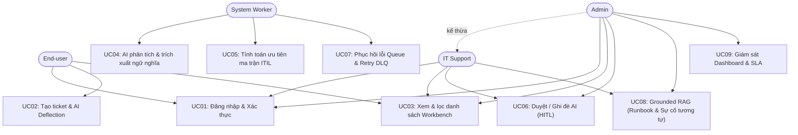
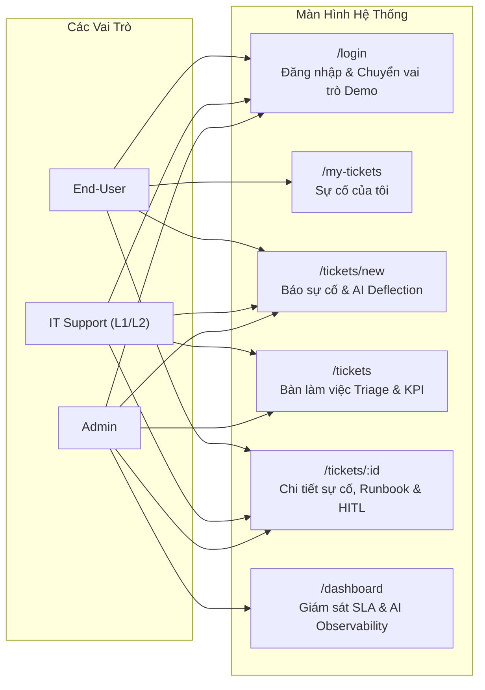
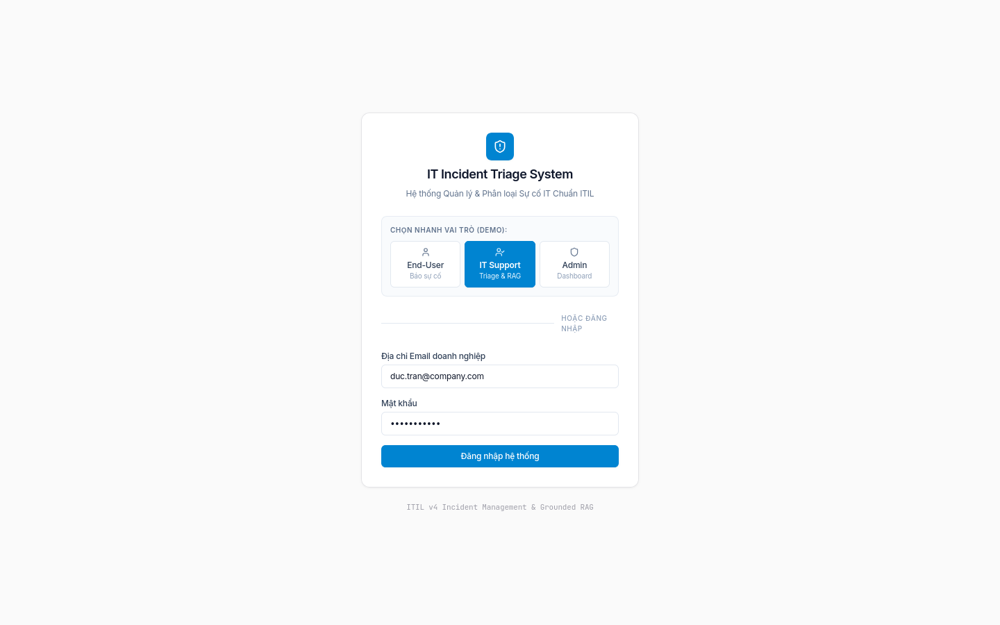
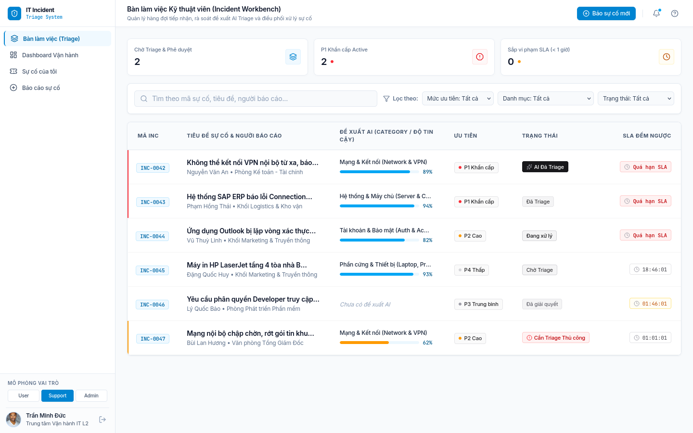
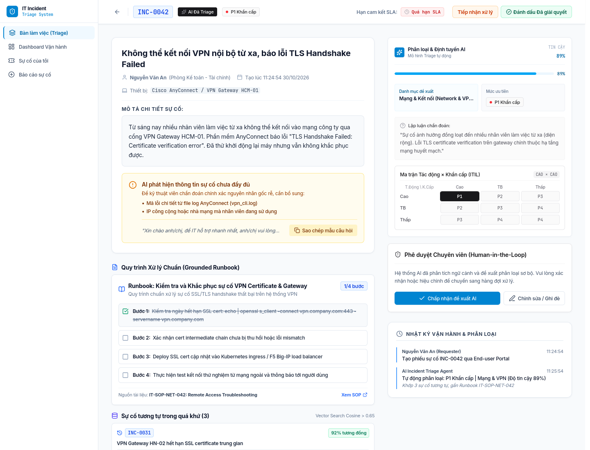
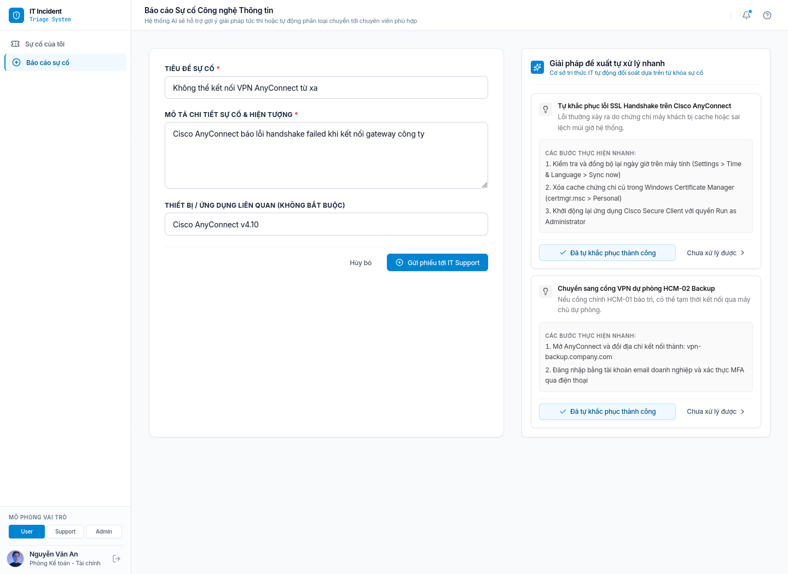
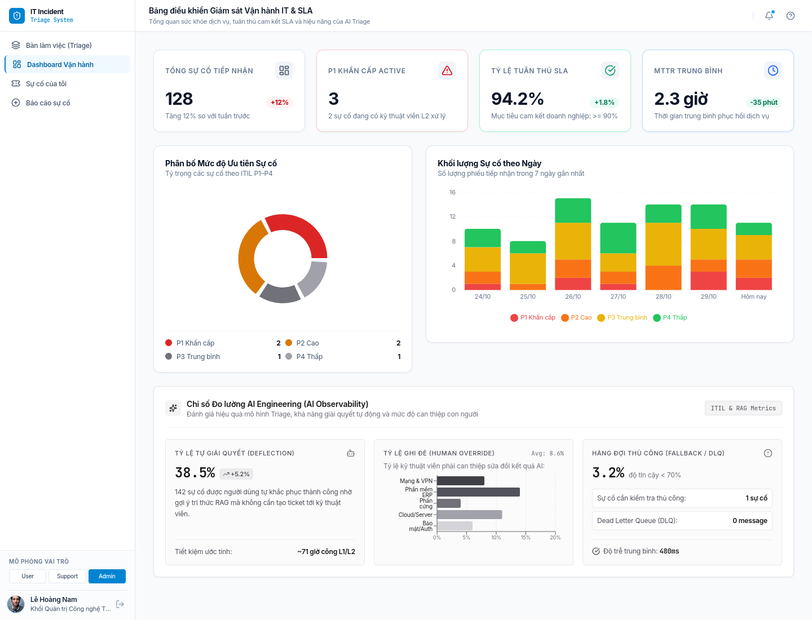
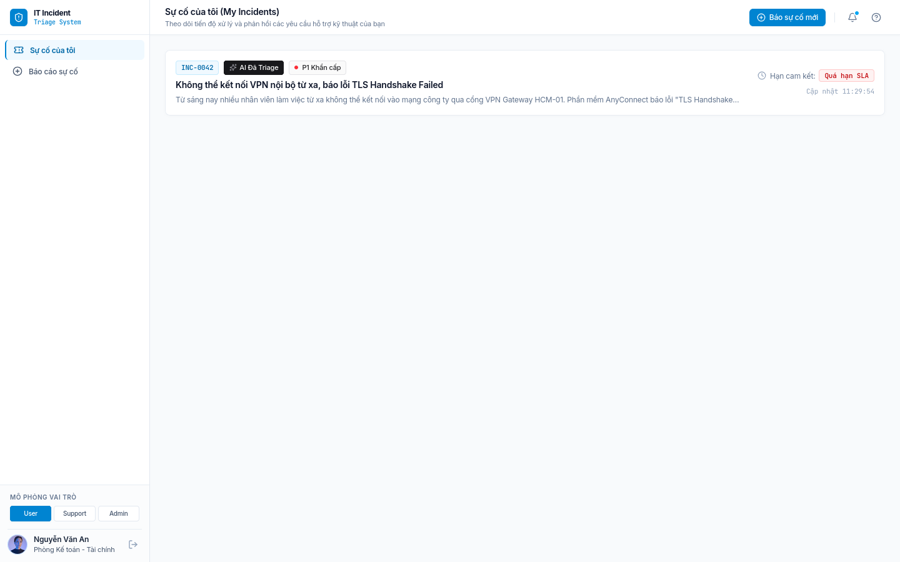

# IT Incident Triage System

Hệ thống ứng dụng AI để tự động phân loại, đánh giá mức độ ưu tiên của ticket sự cố CNTT, phát hiện thông tin còn thiếu và hỗ trợ kỹ thuật viên xử lý nhanh chóng dưới sự giám sát của con người (Human-in-the-loop). Hệ thống kết hợp quản lý sự cố, hàng đợi xử lý nền, phân quyền theo vai trò và kiểm duyệt thông minh.

---

## 1. Phân tích đề bài Top-Down (Research)

Hệ thống được tiếp cận và nghiên cứu theo mô hình **Top-Down**, xuất phát từ bài toán thực tế của các trung tâm vận hành công nghệ thông tin (IT Operations & Service Desk) theo chuẩn **ITIL v4**:
- **Bối cảnh & Vấn đề tồn tại:** Khi xảy ra sự cố, người dùng thường báo cáo mơ hồ hoặc phân loại sai độ ưu tiên (thổi phồng mức độ khẩn cấp). Đội ngũ IT L1 mất thời gian chỉ để đọc, phân loại thủ công và hỏi lại thông tin cơ bản.
- **Giải pháp AI Triage & Grounded RAG:** Ứng dụng mô hình ngôn ngữ lớn kết hợp cơ sở tri thức kỹ thuật số để:
  1. *Tự động phân loại danh mục & phát hiện thông tin còn thiếu (Missing Info Detection).*
  2. *Gợi ý giải pháp tự khắc phục tức thì cho người dùng (AI Deflection) giúp giảm tải số lượng ticket tạo mới.*
  3. *Tính toán độ ưu tiên ITIL (P1–P4) minh bạch dựa trên ma trận Tác động × Khẩn cấp.*
  4. *Đảm bảo tính chịu lỗi với hàng đợi Dead-Letter Queue (DLQ) và giám sát con người (Human-in-the-loop).*

### Sơ đồ tư duy & Cấu trúc sản phẩm (Product Mind Map)

Chi tiết cấu trúc phạm vi, tính năng và phân tích nghiên cứu xem tại:
* [01-SCOPE.md](docs/01-SCOPE.md)
* [02-FEATURES.md](docs/02-FEATURES.md)

---

## 2. Use Case Diagram & User Stories INVEST

### 2.1 Sơ đồ Use Case Tổng thể (Use Case Diagram)

Mô tả chi tiết các tác nhân, kịch bản luồng chính, luồng ngoại lệ, chính sách thử lại và ma trận 3×3 xem tại:
* [03-USE_CASES.md](docs/03-USE_CASES.md)

### 2.2 Danh mục User Stories & Kiểm định Chuẩn INVEST

Backlog phiên bản cốt lõi (V1 Core MVP) gồm **7 User Stories** trọng tâm, bao quát từ tiếp nhận, xử lý nền đến kiểm duyệt con người:
* `US01`: Xác thực và quản lý phiên (Authentication)
* `US02`: Tiếp nhận và tạo ticket sự cố (Ticket Intake)
* `US03`: Bàn làm việc & bộ lọc danh sách (Workbench & Filters)
* `US04`: AI phân loại danh mục sự cố (AI Category Triage)
* `US05`: Đề xuất độ ưu tiên theo ma trận ITIL (Rule-based Priority P1–P4)
* `US06`: Con người duyệt hoặc ghi đè kết quả AI (Human-in-the-loop Override)
* `US07`: Xử lý lỗi retry & hàng đợi dự phòng (Queue Retry & Fallback)

Trước khi sẵn sàng phát triển, mỗi User Story đều được kiểm định nghiêm ngặt theo tiêu chí INVEST:

| Tiêu chí | Ý nghĩa trong hệ thống IT Incident Triage |
| :--- | :--- |
| **Independent (Độc lập)** | Mỗi story tạo ra một tính năng hoàn chỉnh, chỉ phụ thuộc vào điều kiện tiên quyết tối thiểu. |
| **Negotiable (Thương lượng)** | Giao diện và giải pháp công nghệ linh hoạt, giữ nguyên mục tiêu và quyền hạn nghiệp vụ. |
| **Valuable (Có giá trị)** | Mỗi story đều mang lại lợi ích đo lường được cho người dùng hoặc hiệu suất vận hành IT. |
| **Estimable (Ước lượng được)** | Đầu vào, đầu ra, vai trò, phụ thuộc và các kịch bản lỗi đều được tài liệu hóa rõ ràng. |
| **Small (Vừa vặn)** | Mỗi story tập trung vào một năng lực cốt lõi, dễ dàng chia nhỏ thành tác vụ API, DB, UI và Test. |
| **Testable (Kiểm thử được)** | Mọi story đều ánh xạ tới tiêu chí nghiệm thu quan sát được, có metric đo lường và kịch bản lỗi cụ thể. |

Chi tiết toàn bộ bảng phân kỳ Product Backlog (MVP, V2, V3) xem tại [INVEST Requirements](docs/INVEST_REQUIREMENTS.md).

### 2.3 Phân quyền người dùng (Roles & Permissions)

| Quyền hạn / Khả năng | Admin | IT Support | End-user | System Worker |
| :--- | :---: | :---: | :---: | :---: |
| Đăng nhập & quản lý phiên | Có | Có | Có | Không |
| Tạo ticket sự cố mới | Có | Có | Có | Không |
| Xem danh sách ticket | Toàn bộ | Toàn bộ | Chỉ của mình | Không |
| Tự động phân loại danh mục (AI) | Không | Không | Không | Có |
| Tính toán ưu tiên P1–P4 (Rule Matrix) | Không | Không | Không | Có |
| Duyệt đề xuất AI (1-Click Approve) | Có | Có | Không | Không |
| Ghi đè mức ưu tiên kèm lý do (Override) | Có | Có | Không | Không |
| Xử lý retry lỗi nền & Dead-Letter Queue | Không | Không | Không | Có |

> **Lưu ý:** Backend bắt buộc phải thực thi kiểm tra quyền (RBAC) và chính sách "chỉ xem ticket của mình" ở tầng API/DB; việc ẩn hiện nút trên giao diện người dùng chỉ nhằm tối ưu trải nghiệm UI/UX.

---

## 3. Information Architecture & Phân Quyền Màn Hình (Role-to-Screen)

### 3.1 Sơ đồ Phân quyền Vai trò tới Màn hình (Role-to-Screen Mapping)

### 3.2 Bảng Ma trận Màn hình theo Vai trò

| Tuyến đường (Route) | Tên màn hình | Chức năng chính | End-User | IT Support | Admin |
| :--- | :--- | :--- | :---: | :---: | :---: |
| `/login` | Đăng nhập | Xác thực tài khoản & Chọn nhanh vai trò demo | Có | Có | Có |
| `/my-tickets` | Sự cố của tôi | Theo dõi tiến độ & thời gian SLA sự cố cá nhân | Có | Không | Có |
| `/tickets/new` | Báo sự cố mới | Nhập lỗi & AI gợi ý giải pháp tự khắc phục (Deflection) | Có | Có | Có |
| `/tickets` | Bàn làm việc Triage | Quản lý hàng đợi, 3 thẻ KPI Strip, lọc sự cố đa chiều | Không | Có | Có |
| `/tickets/:id` | Chi tiết sự cố | Ma trận ITIL, Grounded Runbook và Phê duyệt HITL | Chỉ xem | Xử lý | Toàn quyền |
| `/dashboard` | Bảng điều khiển | Báo cáo SLA, MTTR và chỉ số AI Engineering | Không | Không | Có |

*Chi tiết kiến trúc thông tin:* [04-INFORMATION_ARCHITECTURE.md](./docs/04-INFORMATION_ARCHITECTURE.md)

---

## 4. Giao diện Người dùng & Trải nghiệm (UI/UX)

#### Happy Case 1: Đăng nhập & Chọn nhanh vai trò (Demo Switcher)
> Card đăng nhập tối giản, hỗ trợ chọn nhanh 1-click giữa các vai trò End-User, IT Support và Admin để nghiệm thu.

---

#### Happy Case 2: Bàn làm việc Kỹ thuật viên (Incident Workbench)
> Hàng đợi sự cố ITIL, 3 thẻ KPI Strip, đồng hồ đếm ngược SLA và thanh độ tin cậy AI màu xanh nhạt dịu mắt.

---

#### Happy Case 3: Chi tiết Sự cố & Phê duyệt Human-in-the-Loop (AI Triage & HITL)
> Ma trận Tác động × Khẩn cấp ITIL 3×3, lập luận AI, checklist Runbook SOP chuẩn hóa và nút phê duyệt/ghi đè.

---

#### Happy Case 4: Người dùng Báo lỗi & AI Tự giải quyết (Self-service Deflection)
> Người dùng gõ mô tả lỗi → AI đối soát RAG gợi ý giải pháp tự khắc phục tức thì giúp giảm tải L1.

---

#### Happy Case 5: Dashboard Giám sát Vận hành & Đo lường AI Engineering (AI Observability)
> 4 chỉ số SLA/MTTR cốt lõi, biểu đồ trực quan và đo lường tỷ lệ Deflection (38.5%), Human Override rate.

---

#### Happy Case 6: Cổng thông tin Người dùng Cuối (My Incidents Portal)
> Nhân viên theo dõi tiến độ và SLA đếm ngược các ticket do chính mình tạo.

---

*Chi tiết toàn bộ báo cáo thiết kế:* [UXUI_DESIGN_REPORT.md](./docs/UXUI_DESIGN_REPORT.md)
