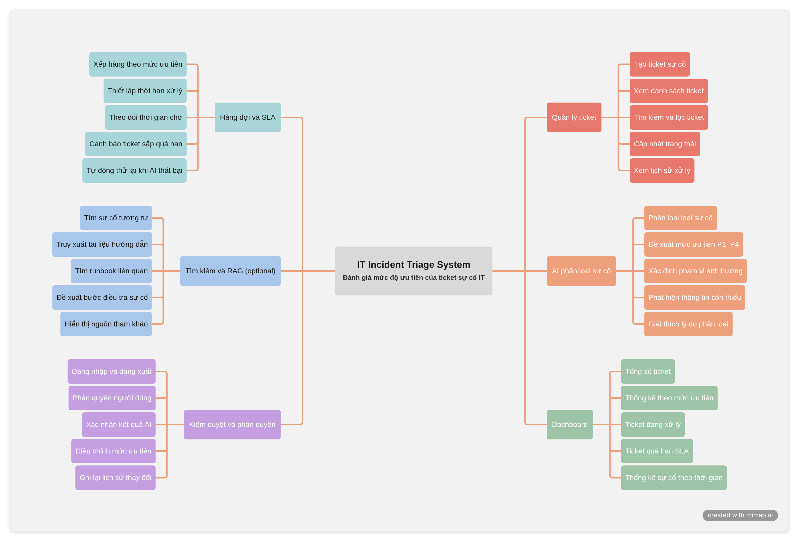

# IT Incident Triage System

Hệ thống ứng dụng AI để tự động phân loại, đánh giá mức độ ưu tiên của ticket sự cố CNTT, phát hiện thông tin còn thiếu và hỗ trợ kỹ thuật viên xử lý nhanh chóng dưới sự giám sát của con người (Human-in-the-loop). Hệ thống kết hợp quản lý sự cố, hàng đợi xử lý nền, phân quyền theo vai trò và kiểm duyệt thông minh.

---

## 1. Yêu cầu hệ thống — INVEST, Use Cases & Tiêu chí nghiệm thu

Tài liệu yêu cầu định nghĩa các năng lực của hệ thống, đối tượng sử dụng, giá trị mang lại và điều kiện thành công có thể kiểm chứng được. Các User Story được rà soát theo chuẩn INVEST và ánh xạ trực tiếp sang Use Case cùng Acceptance Criteria.

### 1.1 Sơ đồ tư duy & Cấu trúc sản phẩm (Product Mind Map)

Chi tiết cấu trúc phạm vi, tính năng và điều hướng trang xem tại:
* [01-SCOPE.md](docs/01-SCOPE.md)
* [02-FEATURES.md](docs/02-FEATURES.md)
* [04-INFORMATION_ARCHITECTURE.md](docs/04-INFORMATION_ARCHITECTURE.md)

### 1.2 Yêu cầu chuẩn INVEST (INVEST Requirements)
Backlog phiên bản cốt lõi (V1 Core MVP) gồm **7 User Stories** trọng tâm, bao quát từ tiếp nhận, xử lý nền đến kiểm duyệt con người:
* `US01`: Xác thực và quản lý phiên (Authentication)
* `US02`: Tiếp nhận và tạo ticket sự cố (Ticket Intake)
* `US03`: Bàn làm việc & bộ lọc danh sách (Workbench & Filters)
* `US04`: AI phân loại danh mục sự cố (AI Category Triage)
* `US05`: Đề xuất độ ưu tiên theo ma trận ITIL (Rule-based Priority P1–P4)
* `US06`: Con người duyệt hoặc ghi đè kết quả AI (Human-in-the-loop Override)
* `US07`: Xử lý lỗi retry & hàng đợi dự phòng (Queue Retry & Fallback)

Trước khi sẵn sàng phát triển, mỗi User Story đều được kiểm định nghiêm ngặt theo tiêu chí INVEST:

| Tiêu chí | Ý nghĩa trong hệ thống IT Incident Triage |
| :--- | :--- |
| **Independent (Độc lập)** | Mỗi story tạo ra một tính năng hoàn chỉnh, chỉ phụ thuộc vào điều kiện tiên quyết tối thiểu. |
| **Negotiable (Thương lượng)** | Giao diện và giải pháp công nghệ linh hoạt, giữ nguyên mục tiêu và quyền hạn nghiệp vụ. |
| **Valuable (Có giá trị)** | Mỗi story đều mang lại lợi ích đo lường được cho người dùng hoặc hiệu suất vận hành IT. |
| **Estimable (Ước lượng được)** | Đầu vào, đầu ra, vai trò, phụ thuộc và các kịch bản lỗi đều được tài liệu hóa rõ ràng. |
| **Small (Vừa vặn)** | Mỗi story tập trung vào một năng lực cốt lõi, dễ dàng chia nhỏ thành tác vụ API, DB, UI và Test. |
| **Testable (Kiểm thử được)** | Mọi story đều ánh xạ tới tiêu chí nghiệm thu quan sát được, có metric đo lường và kịch bản lỗi cụ thể. |

Chi tiết toàn bộ bảng phân kỳ Product Backlog (MVP, V2, V3) xem tại [INVEST Requirements](docs/INVEST_REQUIREMENTS.md).

### 1.3 Use Cases & Sơ đồ tương tác (Use Cases)
Mô tả chi tiết các tác nhân, sơ đồ UML, kịch bản nghiệp vụ (luồng chính, ngoại lệ, chính sách thử lại và ma trận 3×3) xem tại:
* [03-USE_CASES.md](docs/03-USE_CASES.md)

### 1.4 Phân quyền người dùng (Roles & Permissions)

| Quyền hạn / Khả năng | Admin | IT Support | End-user | System Worker |
| :--- | :---: | :---: | :---: | :---: |
| Đăng nhập & quản lý phiên | Có | Có | Có | Không |
| Tạo ticket sự cố mới | Có | Có | Có | Không |
| Xem danh sách ticket | Toàn bộ | Toàn bộ | Chỉ của mình | Không |
| Tự động phân loại danh mục (AI) | Không | Không | Không | Có |
| Tính toán ưu tiên P1–P4 (Rule Matrix) | Không | Không | Không | Có |
| Duyệt đề xuất AI (1-Click Approve) | Có | Có | Không | Không |
| Ghi đè mức ưu tiên kèm lý do (Override) | Có | Có | Không | Không |
| Xử lý retry lỗi nền & Dead-Letter Queue | Không | Không | Không | Có |

> **Lưu ý:** Backend bắt buộc phải thực thi kiểm tra quyền (RBAC) và chính sách "chỉ xem ticket của mình" ở tầng API/DB; việc ẩn hiện nút trên giao diện người dùng chỉ nhằm tối ưu trải nghiệm UI/UX.

---

