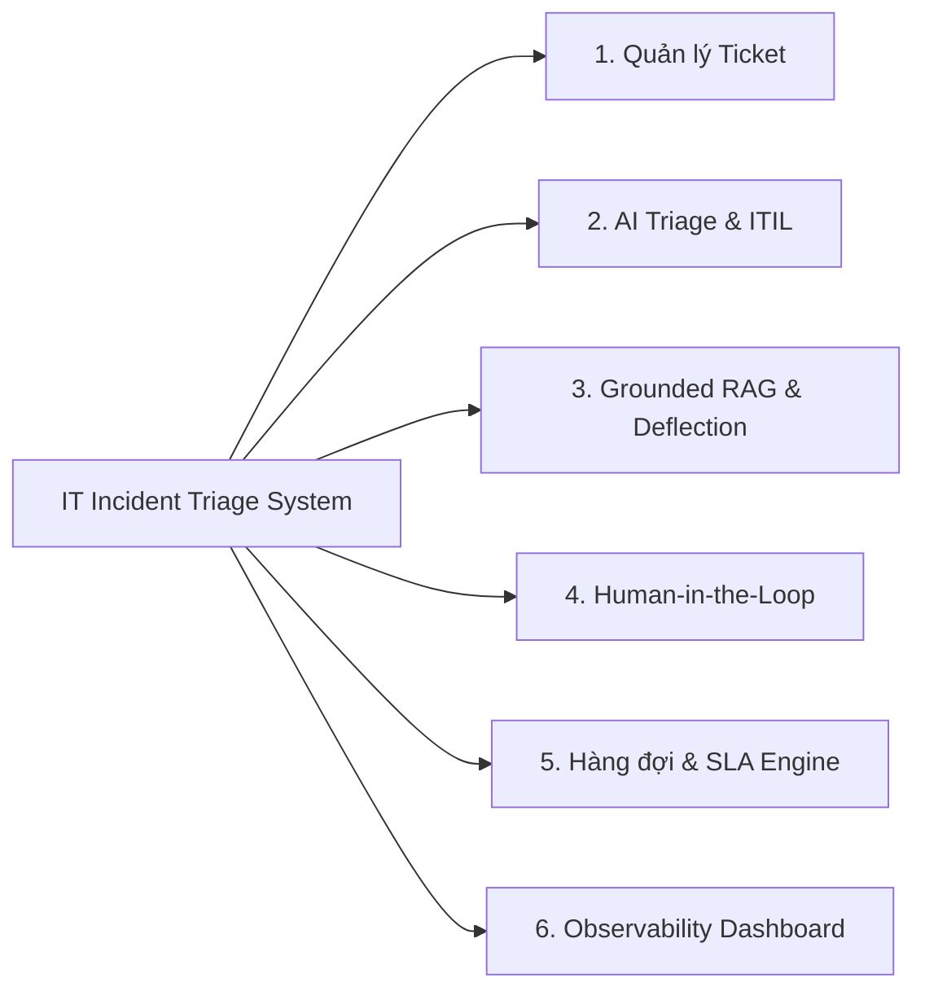

# 02-FEATURES — IT Incident Triage System

Tài liệu chi tiết hóa danh mục tính năng (Feature Matrix) của hệ thống theo 6 cụm chức năng bám sát Mindmap và lộ trình triển khai theo tuần.

---

## I. MA TRẬN TÍNH NĂNG (FEATURE MATRIX)

### Module 1: Quản lý Ticket & Vòng đời (Incident Lifecycle)
* **F1.1 - Tạo sự cố mới:** End-user gửi tiêu đề, mô tả chi tiết, sinh mã duy nhất `INC-xxxx`.
* **F1.2 - Bàn làm việc Kỹ thuật viên (Workbench):** Bảng quản lý tập trung, tìm kiếm nhanh theo mã/từ khóa, lọc đa chiều (Category, P1–P4, Trạng thái).
* **F1.3 - Quản lý trạng thái vòng đời:** Kiểm tra ràng buộc chuyển tiếp (State Machine Validation); yêu cầu nhập tóm tắt giải pháp khi `RESOLVED`.
* **F1.4 - Timeline & Audit Log:** Ghi vết thời gian thực mọi thay đổi (Người tạo, AI phân loại, Kỹ thuật viên sửa đổi, Giải pháp chốt).

### Module 2: AI Phân loại & Ma trận Quy tắc (AI Triage & ITIL)
* **F2.1 - Phân loại danh mục sự cố:** Phân loại tự động (`Hardware`, `Software`, `Network`, `Security`, `Access`) kèm `% Confidence Score`.
* **F2.2 - Trích xuất Impact & Urgency:** Bóc tách mức độ tác động và tính khẩn cấp dưới dạng structured JSON chuẩn xác.
* **F2.3 - Ma trận ITIL Backend (Deterministic):** Tra bảng ma trận 3×3 tự động quy đổi thành mức ưu tiên P1–P4; tự động bật cờ cảnh báo `is_critical` nếu là P1.
* **F2.4 - Đánh giá độ đầy đủ thông tin (Missing Info Detection):** AI tự động phân tích phát hiện thiếu thông tin kỹ thuật (mã lỗi, log, phiên bản) và sinh sẵn câu hỏi gợi ý để Support gửi lại End-user.

### Module 3: Grounded RAG & Self-Service Deflection
* **F3.1 - Smart Deflection (Lúc tạo ticket):** Khi End-user nhập mô tả, hệ thống tự động tìm và gợi ý bài viết giải pháp nhanh. Nếu người dùng chọn "Đã khắc phục", ticket được ghi nhận là Deflected mà không cần tạo ticket mới.
* **F3.2 - Similar Incidents Retrieval:** Truy xuất top 3 ticket đã đóng tương tự trong quá khứ kèm giải pháp đã thành công thông qua Vector Embeddings.
* **F3.3 - Runbook & SOP Matching:** Truy xuất quy trình thao tác chuẩn kèm trích dẫn nguồn và danh sách checklist kiểm tra cho Support.

### Module 4: Kiểm soát Con người (Human-in-the-Loop - HITL)
* **F4.1 - 1-Click Approve:** Kỹ thuật viên xác nhận nhanh đề xuất của AI để chuyển ticket sang hàng đợi xử lý.
* **F4.2 - Human Override:** Cho phép Kỹ thuật viên điều chỉnh lại Danh mục hoặc Priority; bắt buộc nhập trường `override_reason`.
* **F4.3 - Feedback Logging:** Tự động gắn nhãn `is_human_override = true/false` phục vụ đánh giá và đo lường độ chính xác của AI.

### Module 5: Hàng đợi & Cam kết SLA (Resilience & SLA)
* **F5.1 - Queue-based Asynchronous Worker:** Tách biệt luồng nhận ticket khỏi luồng xử lý AI, đảm bảo API luôn phản hồi $< 200\text{ms}$.
* **F5.2 - Retry Policy & Dead-Letter Queue (DLQ):** Tự động thử lại tối đa 3 lần với Exponential Backoff (2s, 6s) khi LLM gặp lỗi/timeout. Quá 3 lần chuyển sang `MANUAL_TRIAGE_REQUIRED` để không làm mất ticket.
* **F5.3 - SLA Countdown:** Tự động tính hạn phản hồi và xử lý theo mức P1–P4 (P1: 2h, P2: 8h, P3: 24h, P4: 72h). Hiển thị trực quan cảnh báo sắp trễ hạn.

### Module 6: Giám sát Vận hành & Đo lường AI (Observability Dashboard)
* **F6.1 - Thống kê vận hành:** Tổng số sự cố, phân bổ theo độ ưu tiên P1–P4, tỷ lệ ticket vi phạm SLA, thời gian xử lý trung bình (MTTR).
* **F6.2 - AI Performance Metrics:**
  * **Deflection Rate:** Tỷ lệ người dùng tự khắc phục sự cố thành công mà không cần tạo ticket.
  * **AI Accuracy / Override Rate:** Tỷ lệ đề xuất của AI được duyệt thẳng vs. bị con người chỉnh sửa lại theo từng danh mục.
  * **Worker Health & Failure Rate:** Thời gian phản hồi trung bình của worker và tỷ lệ ticket phải vào hàng đợi thủ công.

---

## II. LỘ TRÌNH TRIỂN KHAI (PHASED DELIVERY)

| Giai đoạn | Trọng tâm kỹ thuật | Tính năng bàn giao |
| :--- | :--- | :--- |
| **Phase 1: Core Architecture (Tuần 1–2)** | Nền tảng SE vững chắc + AI Triage cơ bản | Module 1 (F1.1, F1.2), Module 2 (F2.1, F2.2, F2.3), Module 4 (F4.1, F4.2), Module 5 (F5.1, F5.2). |
| **Phase 2: Grounded RAG & SLA (Tuần 3)** | Chiều sâu AI & Quản trị vận hành | Module 3 (F3.2, F3.3), Module 2 (F2.4), Module 5 (F5.3), Module 1 (F1.3, F1.4). |
| **Phase 3: Deflection & Observability (Tuần 4)** | Hoàn thiện điểm nhấn sản phẩm cho Mentor | Module 3 (F3.1), Module 6 (F6.1, F6.2). |
