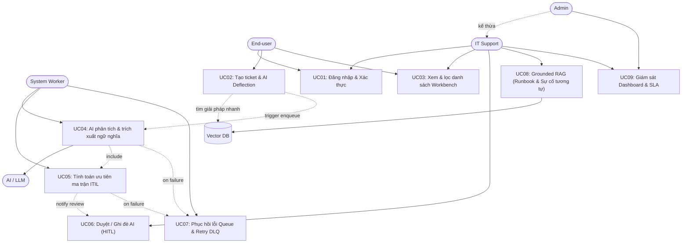

# 03-USE_CASES — IT Incident Triage System

Tài liệu hợp nhất toàn diện về Tác nhân (Actors), Sơ đồ Use Case (Use Case Diagram), Ma trận Phân quyền và Đặc tả chi tiết từng Use Case cho hệ thống.

---

## I. TÁC NHÂN HỆ THỐNG (ACTORS & ROLES)

| Role | Tên hiển thị trên UI | Mô tả quyền hạn cốt lõi |
| :--- | :--- | :--- |
| **ADMIN** | Administrator | Toàn quyền cấu hình hệ thống, quản lý người dùng và giám sát toàn bộ báo cáo Dashboard. |
| **IT_SUPPORT** | IT Support Specialist | Xem toàn bộ ticket, duyệt/ghi đè đề xuất AI, xem RAG Runbook/Similar Tickets và xử lý sự cố. |
| **END_USER** | Employee / End-user | Báo cáo sự cố, nhận gợi ý tự khắc phục (Deflection) và theo dõi ticket do chính mình tạo. |
| **SYSTEM** | Background Worker | Tác nhân hệ thống: Xử lý queue bất đồng bộ, gọi AI trích xuất dữ kiện, tính SLA, retry và DLQ. |

---

## II. SƠ ĐỒ USE CASE TỔNG THỂ

---

## III. MA TRẬN PHÂN QUYỀN USE CASE

| Mã UC | Tên Use Case | ADMIN | IT_SUPPORT | END_USER | SYSTEM |
| :--- | :--- | :---: | :---: | :---: | :---: |
| **UC01** | Đăng nhập & Cấp JWT token | x | x | x | - |
| **UC02** | Tạo ticket & AI Smart Deflection | x | x | x | - |
| **UC03** | Xem & lọc danh sách sự cố | x (Tất cả) | x (Tất cả) | x (Chỉ của mình) | - |
| **UC04** | AI phân loại & trích xuất dữ kiện | - | - | - | x |
| **UC05** | Tính toán ưu tiên theo ma trận ITIL | - | - | - | x |
| **UC06** | Thẩm định & Ghi đè AI (HITL) | x | x | - | - |
| **UC07** | Tự động Retry & Dead-Letter Queue | - | - | - | x |
| **UC08** | Truy xuất Grounded RAG & Runbook | x | x | - | - |
| **UC09** | Xem Dashboard Vận hành & SLA | x | x | - | - |

---

## IV. QUY TẮC NGHIỆP VỤ CỐT LÕI (BUSINESS RULES)

### 1. Ma trận Ưu tiên ITIL 3×3 (Priority Matrix)
$$\text{Priority} = \text{Impact} \times \text{Urgency}$$

| Mức tác động (Impact) \ Tính khẩn cấp (Urgency) | **HIGH** | **MEDIUM** | **LOW** |
| :--- | :---: | :---: | :---: |
| **HIGH (Diện rộng)** |  **P1 (Critical)** |  **P2 (High)** |  **P3 (Medium)** |
| **MEDIUM (Phòng ban)** |  **P2 (High)** |  **P3 (Medium)** |  **P4 (Low)** |
| **LOW (Cá nhân)** |  **P3 (Medium)** |  **P4 (Low)** |  **P4 (Low)** |

### 2. Tách biệt trường dữ liệu AI vs. Quyết định Chính thức
* Đề xuất của AI: `ai_category`, `ai_confidence_score`, `ai_suggested_priority`, `ai_missing_info`.
* Quyết định của con người: `final_category`, `final_priority`, `is_human_override`, `override_reason`.

---

## V. ĐẶC TẢ CHI TIẾT TỪNG USE CASE

#### UC01: Đăng nhập & Cấp JWT token
* **Tác nhân:** ADMIN, IT_SUPPORT, END_USER
* **Luồng chính:** Người dùng nhập email/mật khẩu $\rightarrow$ Hệ thống xác thực $\rightarrow$ Cấp JWT token chứa Role $\rightarrow$ Điều hướng trang phù hợp (ADMIN/IT_SUPPORT vào `/tickets`, END_USER vào `/my-tickets`).
* **Ngoại lệ:** Sai thông tin báo 401; sai quá 5 lần khóa tạm 15 phút.

#### UC02: Tạo ticket & AI Smart Deflection
* **Tác nhân:** END_USER (hoặc Support tạo hộ)
* **Luồng chính:** 
  1. Người dùng nhập tiêu đề, mô tả.
  2. Hệ thống tự động tìm kiếm các bài viết FAQ/Runbook phù hợp và hiển thị đề xuất tự khắc phục (Deflection).
  3. Nếu người dùng bấm "Đã tự khắc phục được", hệ thống ghi nhận Deflection thành công (không tạo ticket).
  4. Nếu bấm "Gửi sự cố tới IT", hệ thống lưu ticket vào DB với trạng thái `PENDING_TRIAGE`, đẩy task vào Queue và trả về mã `INC-xxxx`.

#### UC03: Xem & lọc danh sách sự cố (Workbench)
* **Tác nhân:** ADMIN, IT_SUPPORT, END_USER
* **Luồng chính:** Client gửi request kèm tham số lọc/phân trang $\rightarrow$ Phân quyền phạm vi (END_USER chỉ xem ticket của mình; ADMIN/IT_SUPPORT xem toàn bộ) $\rightarrow$ Sắp xếp theo mức độ ưu tiên P1 $\rightarrow$ P4 và thời gian tạo mới nhất.

#### UC04: AI phân tích & trích xuất ngữ nghĩa
* **Tác nhân:** SYSTEM (AI Background Worker)
* **Luồng chính:** Worker nhận task từ queue $\rightarrow$ Gọi LLM bóc tách:
  * Category (`Hardware`, `Network`, `Software`...) kèm `confidence_score`.
  * `Impact` & `Urgency` (HIGH / MEDIUM / LOW).
  * Kiểm tra dữ liệu kỹ thuật còn thiếu (`missing_info`).
* **Ngoại lệ:** Timeout hoặc lỗi mạng $\rightarrow$ Kích hoạt UC07.

#### UC05: Tính toán ưu tiên ma trận ITIL
* **Tác nhân:** SYSTEM (Worker + ITIL Rule Engine)
* **Luồng chính:** Lấy `Impact` và `Urgency` từ UC04 $\rightarrow$ Tra ma trận ITIL 3×3 tính ra `ai_suggested_priority` (P1–P4) $\rightarrow$ Cập nhật ticket sang trạng thái `AI_SUGGESTED` (chờ con người thẩm định).

#### UC06: Duyệt / Ghi đè AI (HITL)
* **Tác nhân:** IT_SUPPORT, ADMIN
* **Kịch bản A (Chấp thuận):** Kỹ thuật viên nhấn "Chấp nhận" $\rightarrow$ `final_priority = ai_suggested_priority`, `status = TRIAGED`, `is_human_override = false`.
* **Kịch bản B (Ghi đè):** Kỹ thuật viên chỉnh sửa Category/Priority $\rightarrow$ Bắt buộc nhập `override_reason` $\rightarrow$ Cập nhật `final_priority` mới, `status = TRIAGED`, `is_human_override = true`.

#### UC07: Phục hồi lỗi Queue & Retry DLQ
* **Tác nhân:** SYSTEM (Queue Worker)
* **Chính sách:** Thử tối đa 3 lần với Exponential Backoff (2s, 6s) khi LLM lỗi/timeout.
* **Luồng ngoại lệ (Quá 3 lần thử):** Đẩy task vào Dead-Letter Queue (DLQ) $\rightarrow$ Cập nhật ticket sang `MANUAL_TRIAGE_REQUIRED` với `final_priority = UNASSIGNED` để Kỹ thuật viên xử lý thủ công.

#### UC08: Grounded RAG (Runbook & Sự cố tương tự)
* **Tác nhân:** IT_SUPPORT, ADMIN
* **Luồng chính:** Tại trang chi tiết ticket, hệ thống vector search tự động truy xuất top 3 sự cố trong quá khứ đã được giải quyết kèm quy trình Runbook nội bộ, hiển thị trích dẫn nguồn và các bước kiểm tra gợi ý.

#### UC09: Giám sát Dashboard & SLA
* **Tác nhân:** ADMIN, IT_SUPPORT
* **Luồng chính:** Hiển thị thẻ KPI thời gian thực: phân bổ P1–P4, ticket sắp hoặc đã vi phạm SLA, tỷ lệ Deflection thành công, và tỷ lệ con người ghi đè kết quả của AI.
