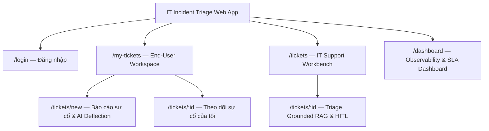
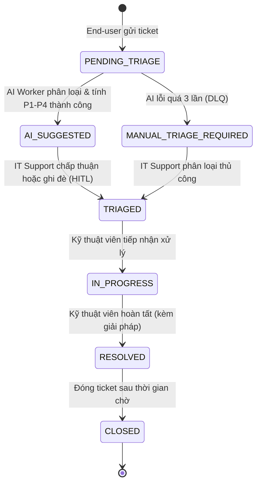

# 04-IA — IT Incident Triage System
**Design status:** TARGET V1 (Bám sát Mindmap & Chuẩn hóa SE-AI)

---

### I. SƠ ĐỒ SITEMAP

---

### II. CẤU TRÚC TỪNG TRANG

---

#### 1. `/login` — Đăng nhập & Chọn vai trò
- **Role:** Public
- Form đăng nhập chuẩn JWT: Email, Mật khẩu.
- Quick Role Selector (phục vụ demo nhanh cho Mentor): Chuyển nhanh giữa `END_USER`, `IT_SUPPORT`, `ADMIN`.
- Thông báo lỗi xác thực hoặc tài khoản bị khóa tạm khi nhập sai nhiều lần.

---

#### 2. `/my-tickets` — Không gian làm việc cá nhân (End-User Workspace)
- **Role:** `END_USER`
- Header: Thông tin nhân viên, nút `[+ Báo cáo sự cố mới]`.
- Danh sách sự cố cá nhân: Mã `INC-xxxx`, Tiêu đề, Ngày tạo, Trạng thái (kèm timeline tiến độ rút gọn), Mức ưu tiên.
- Bộ lọc nhanh: Tất cả | Đang xử lý | Đã giải quyết.

---

#### 3. `/tickets/new` — Báo cáo sự cố & AI Smart Deflection (Self-Service)
- **Role:** `END_USER`, `IT_SUPPORT`, `ADMIN`
- **Cột trái — Form nhập liệu:**
  - Tiêu đề sự cố, Mô tả chi tiết vấn đề, Thiết bị/Hệ thống ảnh hưởng.
  - Nút `[Hủy]` và `[Gửi sự cố tới IT Support]`.
- **Cột phải — AI Self-Service Panel (Deflection):**
  - Tự động kích hoạt khi người dùng gõ mô tả (debounce 500ms).
  - Gợi ý 1–2 giải pháp/FAQ khắc phục nhanh (VD: Hướng dẫn cấp lại quyền, cách restart VPN...).
  - Tùy chọn phản hồi:
    - `[✓ Đã tự khắc phục được]` $\rightarrow$ Ghi nhận Deflected ticket, không tạo ticket mới.
    - `[Chưa giải quyết được]` $\rightarrow$ Tiếp tục bấm gửi ticket.

---

#### 4. `/tickets` — Bàn làm việc Kỹ thuật viên (IT Support Workbench)
- **Role:** `IT_SUPPORT`, `ADMIN`
- **KPI Bar nhanh:** Số ticket chờ triage (`PENDING_TRIAGE`), Cảnh báo khẩn cấp (`P1`), Sắp vi phạm SLA.
- **Thanh công cụ:** Ô tìm kiếm nhanh (mã hoặc tiêu đề), Bộ lọc đa chiều (Category, P1–P4, Trạng thái).
- **Bảng dữ liệu (Incident Table):**
  - Mã ticket, Tiêu đề, Người báo cáo, Đề xuất AI (Category, Impact × Urgency), Final Priority, Trạng thái, SLA đếm ngược.
  - Chỉ báo thị giác: Highlight viền đỏ nổi bật cho P1, viền cam cho ticket cần can thiệp thủ công (`MANUAL_TRIAGE_REQUIRED`).

---

#### 5. `/tickets/:id` — Chi tiết sự cố, Grounded RAG & HITL Override
- **Role:** `IT_SUPPORT`, `ADMIN` (End-user chỉ xem read-only)
- **Header:** Mã ticket, Trạng thái vòng đời, Đồng hồ đếm ngược SLA, Người báo cáo.
- **Bố cục 2 cột chuyên sâu:**
  - **Cột trái — Thông tin sự cố & Trợ lý điều tra:**
    - Tiêu đề, nội dung chi tiết.
    - **AI Missing Info Check:** Cảnh báo nếu ticket thiếu thông tin kỹ thuật (mã lỗi, log, ảnh chụp) kèm nút `[Sao chép mẫu câu hỏi gửi End-user]`.
    - **Grounded RAG Panel:**
      - *Top 3 sự cố tương tự trong quá khứ* kèm cách đã giải quyết thành công.
      - *Tài liệu Runbook/SOP khuyến nghị* kèm checklist các bước kiểm tra.
  - **Cột phải — AI Triage & HITL Panel:**
    - Danh mục đề xuất + % Confidence Score.
    - Ma trận Impact × Urgency $\rightarrow$ Đề xuất Priority P1–P4.
    - Thao tác thẩm định (Human-in-the-Loop):
      - `[✓ Chấp nhận đề xuất]` (1-click approve).
      - `[Chỉnh sửa / Ghi đè]`: Dropdown chọn lại Priority/Category + ô nhập lý do bắt buộc (`override_reason`).
    - Cập nhật tiến độ xử lý: `TRIAGED` $\rightarrow$ `IN_PROGRESS` $\rightarrow$ `RESOLVED` (bắt buộc nhập solution).

---

#### 6. `/dashboard` — Giám sát Vận hành & Đo lường AI (Observability)
- **Role:** `ADMIN`, `IT_SUPPORT`
- **Hàng 1 — Chỉ số Vận hành (Operational Metrics):**
  - Tổng số sự cố, Phân bố P1–P4 (Biểu đồ tròn/cột), Tỷ lệ tuân thủ SLA (%), Thời gian xử lý trung bình (MTTR).
- **Hàng 2 — Chỉ số Chất lượng AI (AI Engineering Metrics):**
  - **Tỷ lệ Deflection:** Số sự cố người dùng tự giải quyết thành công qua Smart Suggestion.
  - **Tỷ lệ Human Override:** Tỷ lệ kỹ thuật viên phải can thiệp sửa kết quả của AI (theo từng danh mục sự cố).
  - **Độ tin cậy mô hình:** Độ trễ trung bình của AI Worker, Tỷ lệ ticket chuyển vào hàng đợi xử lý lỗi (DLQ/Manual).

---

### III. SƠ ĐỒ TRẠNG THÁI VÒNG ĐỜI TICKET

