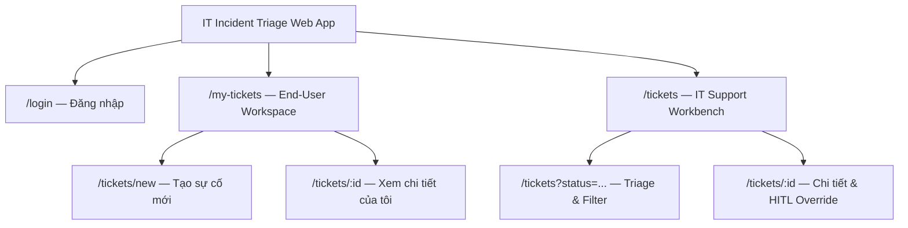
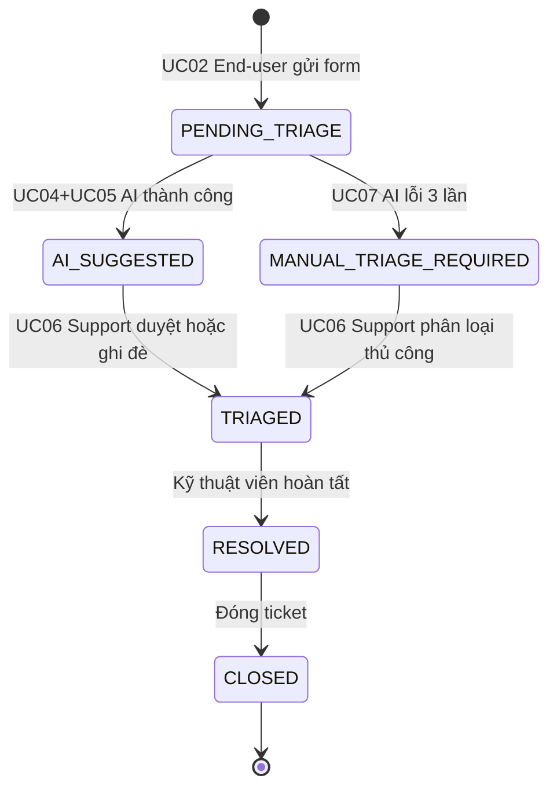

# Information Architecture — IT Incident Triage System
**Design status:** TARGET V1 (Core MVP)

---

### I. SƠ ĐỒ SITEMAP

---

### II. CẤU TRÚC TỪNG TRANG

---

#### 1. `/login` — Đăng nhập
- **Role:** Public
- Logo + tiêu đề hệ thống
- Form: Email, Mật khẩu, nút Đăng nhập
- Alert lỗi / tài khoản bị khóa 15 phút

---

#### 2. `/my-tickets` — Danh sách sự cố cá nhân
- **Role:** `END_USER`
- Navbar: tên người dùng, badge vai trò
- Action bar: nút `[+ Báo cáo sự cố mới]`
- Tabs lọc: Tất cả | Đang xử lý | Đã giải quyết
- Bảng ticket: Mã (`INC-xxxx`), Tiêu đề, Ngày, Trạng thái, Ưu tiên
- Empty state & Phân trang

---

#### 3. `/tickets/new` — Tạo ticket sự cố
- **Role:** `END_USER`, `IT_SUPPORT`, `ADMIN`
- Navbar + breadcrumb
- Input: Tiêu đề tóm tắt, Mô tả chi tiết
- Helper text: "AI sẽ tự động phân loại sau khi gửi"
- Actions: `[Hủy]` | `[Gửi sự cố]` (loading spinner)

---

#### 4. `/tickets` — Bàn làm việc kỹ thuật viên
- **Role:** `IT_SUPPORT`, `ADMIN`
- Thẻ đếm nhanh: `PENDING_TRIAGE` | `AI_SUGGESTED` | `MANUAL_TRIAGE_REQUIRED`
- Bộ lọc: Trạng thái, Mức ưu tiên, Reset
- Bảng ticket: Mã, Tiêu đề, Người gửi, Đề xuất AI, Priority (P1–P4), Trạng thái
- Row highlight: viền đỏ P1, viền cam `MANUAL_TRIAGE_REQUIRED`

---

#### 5. `/tickets/:id` — Chi tiết sự cố & HITL Override
- **Role:** `IT_SUPPORT`, `ADMIN` (End-user chỉ read-only)
- Header: Mã ticket, Ngày giờ, Người báo cáo, Badge trạng thái
- **Cột trái:** Tiêu đề + mô tả sự cố, Error banner nếu AI lỗi
- **Cột phải — AI Triage Panel:**
  - Danh mục đề xuất + % Confidence Score
  - Impact × Urgency badges → Priority P1–P4
  - `[✓ Chấp nhận]` hoặc Override dropdown + input lý do + `[Xác nhận]`

---

### III. SƠ ĐỒ TRẠNG THÁI TICKET

