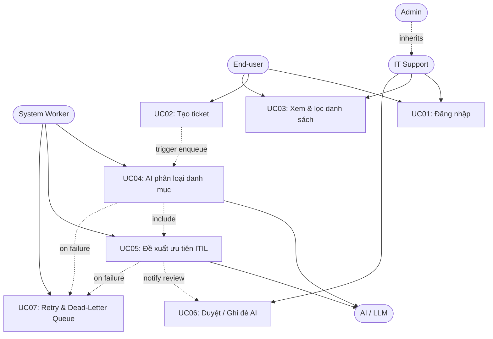

# Use Case Diagram — IT Incident Triage System
**Design status:** TARGET V1 (Core MVP)

---

### I. SƠ ĐỒ USE CASE TỔNG THỂ

---

### II. BẢNG QUAN HỆ & GIẢI THÍCH LIÊN KẾT

| Từ | Đến | Loại quan hệ | Ý nghĩa |
| :--- | :--- | :---: | :--- |
| **Admin** | **IT Support** | Generalization | Admin sở hữu toàn bộ quyền của IT Support. |
| **End-user** | UC01, UC02, UC03 | Association | Tạo ticket và theo dõi ticket của chính mình. |
| **IT Support** | UC01, UC03, UC06 | Association | Xem toàn bộ ticket và duyệt/ghi đè đề xuất AI. |
| **Background Worker** | UC04, UC05, UC07 | Association | Thực thi phân loại NLP, ma trận ITIL và retry. |
| UC04, UC05 | **LLM Service** | External Service | Worker giao tiếp với LLM để phân tích ngữ nghĩa. |
| **UC02** | **UC04** | `<<trigger>>` | Tạo ticket thành công → enqueue tác vụ phân loại. |
| **UC04** | **UC05** | `<<include>>` | Phân loại danh mục luôn kèm tính Priority P1–P4. |
| UC04 / UC05 | **UC07** | `<<on failure>>` | Gọi AI lỗi (timeout, 429) → kích hoạt retry/DLQ. |
| **UC05** | **UC06** | Dependency | Kết quả AI là đề xuất, chờ con người thẩm định. |
