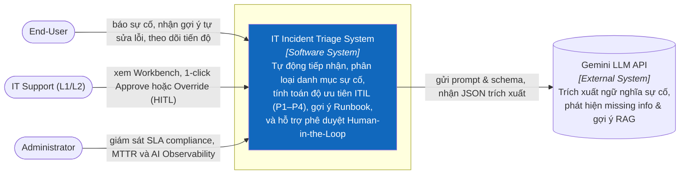
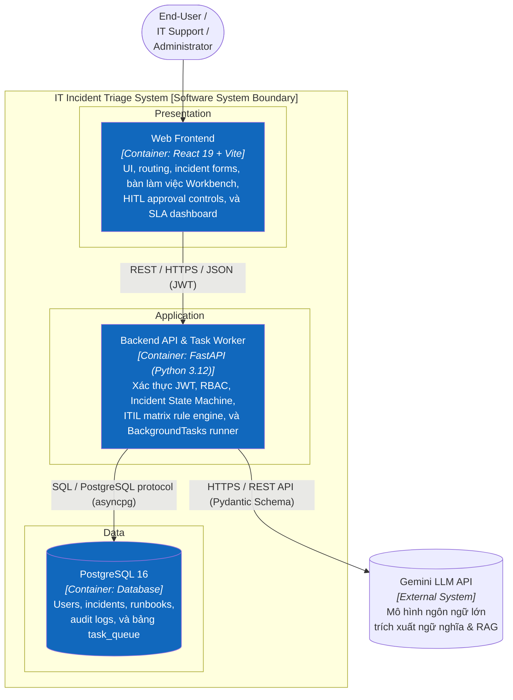
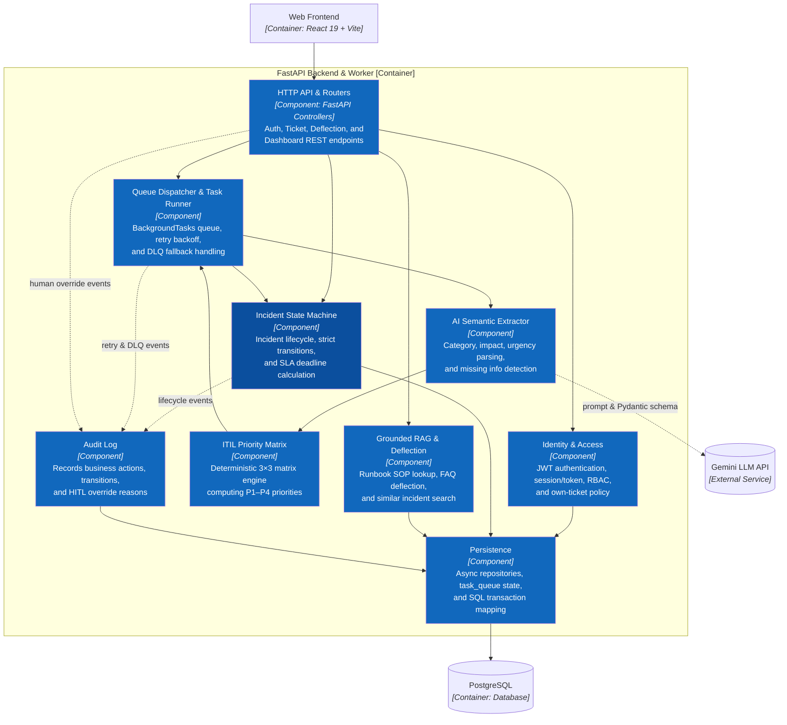
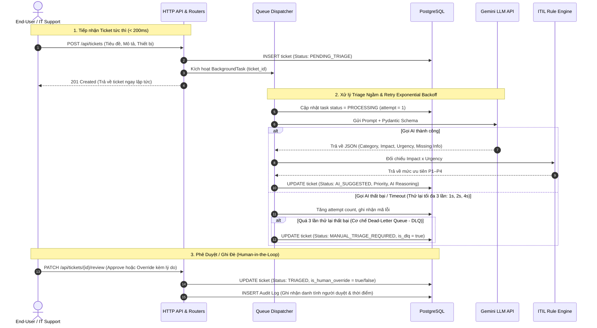

# C4_ARCHITECTURE — IT Incident Triage System
**Design status:** VALIDATED & APPROVED (C1 Context, C2 Container, C3 Component)

Tài liệu thiết kế kiến trúc hệ thống theo mô hình **C4 Model** (Context, Container, Component), trực quan hóa bằng Mermaid flowchart chuẩn C4 với cú pháp trực quan, phân rã ranh giới hệ thống, tầng thực thi và component nội bộ.

---

## II. CẤP ĐỘ 1: C1 — SYSTEM CONTEXT

### C1 — System Context

### Bảng đặc tả giao tiếp C1:
* **End-User $\leftrightarrow$ IT Incident Triage System:** Giao tiếp qua Web Browser, cung cấp Self-Service Portal (báo lỗi, nhận AI Deflection giải pháp tức thì, xem tiến độ xử lý).
* **IT Support $\leftrightarrow$ IT Incident Triage System:** Tiếp nhận hàng đợi sự cố trên Workbench, xem bằng chứng và lập luận AI, thực hiện phê duyệt (1-click Approve) hoặc ghi đè (Override có lý do).
* **Admin $\leftrightarrow$ IT Incident Triage System:** Giám sát dashboard SLA, MTTR và các chỉ số AI Observability.
* **IT Incident Triage System $\leftrightarrow$ Gemini LLM API:** Giao thức HTTPS REST API, trích xuất cấu trúc văn bản sự cố theo định dạng JSON Schema định sẵn.

---

## III. CẤP ĐỘ 2: C2 — CONTAINER

### C2 — Container

### Đặc tính kỹ thuật của các Container:
1. **Web Frontend:**
   * **Công nghệ:** React 19, TypeScript, Vite, Tailwind CSS v4, Lucide React, Recharts.
   * **Trách nhiệm:** Trực quan hóa toàn bộ trải nghiệm người dùng, điều hướng theo vai trò (Role-based views), gọi REST API.
2. **Backend API & Task Worker:**
   * **Công nghệ:** Python 3.12, FastAPI, Pydantic v2, Uvicorn.
   * **Trách nhiệm:** Cung cấp API tiếp nhận ticket siêu nhanh ($< 200\text{ms}$), kích hoạt `BackgroundTasks` xử lý phân loại ngầm, đối soát ma trận ITIL cứng, quản lý retry/DLQ và ghi log kiểm toán.
3. **PostgreSQL Database:**
   * **Công nghệ:** PostgreSQL 16.
   * **Trách nhiệm:** Lưu trữ bền vững dữ liệu quan hệ, lịch sử thay đổi trạng thái (Audit Trail), và điều phối trạng thái nhiệm vụ ngầm (ACID persistence).
4. **Gemini LLM API:**
   * **Trách nhiệm:** Cung cấp dịch vụ mô hình ngôn ngữ lớn để trích xuất ngữ nghĩa và tìm kiếm giải pháp RAG.

---

## IV. CẤP ĐỘ 3: C3 — COMPONENT (BACKEND API & TASK WORKER)

### C3 — Component

### Bảng phân nhiệm chi tiết từng Component:

| Component | Phân loại | Công nghệ | Nhiệm vụ chính |
|:---|:---|:---|:---|
| **HTTP API & Routers** | Interface | FastAPI APIRouter | Điểm tiếp nhận request từ Web Frontend; điều phối luồng tới các component nghiệp vụ; trả về response chuẩn hóa JSON. |
| **Identity & Access** | Security | `python-jose`, `passlib` | Xác thực đăng nhập, mã hóa mật khẩu, kiểm tra quyền hạn (Role-based Access Control) cho từng API endpoint. |
| **Incident State Machine** | Domain Core | Pure Python Class | Quản trị vòng đời sự cố, đảm bảo các bước chuyển đổi trạng thái hợp lệ, ngăn chặn thao tác nhảy cóc. |
| **Queue Dispatcher & Runner** | Asynchronous | FastAPI `BackgroundTasks` | Tiếp nhận ticket ID, gọi AI Triage ngầm, theo dõi số lần thử lại (tối đa 3 lần với exponential backoff), đẩy sang DLQ (`MANUAL_TRIAGE_REQUIRED`) nếu lỗi. |
| **AI Semantic Extractor** | AI Integration | `google-genai`, Pydantic v2 | Đóng gói Prompt hệ thống, ép kiểu phản hồi của LLM vào Schema nghiêm ngặt (`category`, `impact`, `urgency`, `missing_info`). |
| **ITIL Priority Matrix** | Business Logic | Pure Deterministic Code | Ánh xạ ma trận cứng $3 \times 3$ giữa Tác động (Impact) và Mức khẩn cấp (Urgency) để xác định độ ưu tiên P1–P4. |
| **Grounded RAG & Deflection** | Knowledge Service | Domain Service + PostgreSQL FTS | Tìm kiếm văn bản Runbook tương ứng với sự cố và truy xuất top các sự cố tương tự trong quá khứ. |
| **Data Access & Audit Repo** | Data Persistence | SQLAlchemy 2.0 (Async) | Quản lý kết nối PostgreSQL qua `asyncpg`, thực thi CRUD và tự động ghi log vào bảng `audit_logs` khi có hành động duyệt HITL. |

---

## V. LUỒNG DỮ LIỆU & KHẢ NĂNG CHỊU LỖI (DATA FLOW & FAULT TOLERANCE)

### Sơ đồ tuần tự: Tiếp nhận, Triage ngầm và Phê duyệt HITL

---

## VI. BẢO MẬT & PHÂN QUYỀN (SECURITY & RBAC)

| Vai trò | Phạm vi dữ liệu xem | Thao tác được phép |
|:---|:---|:---|
| **End-User** | Chỉ xem ticket do chính mình tạo | Tạo ticket mới, xem gợi ý Deflection, xem tiến độ ticket của mình. |
| **IT Support (L1/L2)** | Xem toàn bộ ticket trong hệ thống | Bàn làm việc Workbench, duyệt AI (Approve), ghi đè độ ưu tiên (Override kèm lý do), cập nhật tiến độ (In Progress / Resolved). |
| **Admin** | Toàn quyền trên toàn bộ dữ liệu | Xem Observability Dashboard, cấu hình hệ thống, quản lý người dùng, xem toàn bộ Audit Logs. |
