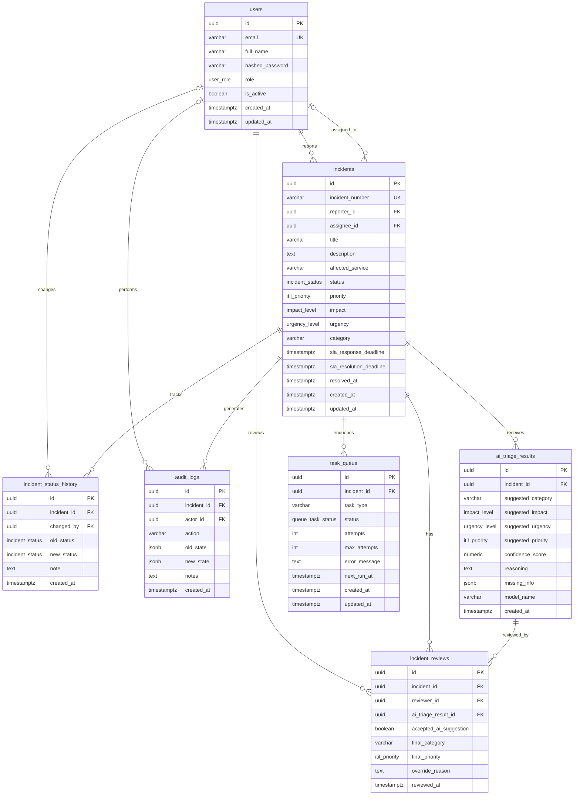

# DATABASE_DESIGN — IT Incident Triage System
**Design status:** VALIDATED & APPROVED (PostgreSQL 16 · Normalized Entities · Mermaid ERD & DBML)

Tài liệu thiết kế mô hình cơ sở dữ liệu quan hệ cho hệ thống **IT Incident Triage System**. Thiết kế đạt chuẩn 3NF, phân định rõ ràng giữa **dữ liệu sự cố nghiệp vụ**, **kết quả AI đề xuất**, **lịch sử thẩm định Human-in-the-Loop (HITL)**, và **vòng đời trạng thái sự cố**.

---

## I. SƠ ĐỒ THỰC THỂ QUAN HỆ (MERMAID ER DIAGRAM)



---

## II. ĐẶC TẢ LƯỢC ĐỒ DBML (DATABASE MARKUP LANGUAGE)

> Tương thích chuẩn 100% với [dbdiagram.io](https://dbdiagram.io) và các công cụ xuất DDL SQL.

```dbml
// ============================================================================
// IT Incident Triage System — Database Markup Language (DBML)
// Engine: PostgreSQL 16
// ============================================================================

// ----------------------------------------------------------------------------
// ENUMS
// ----------------------------------------------------------------------------

Enum user_role {
  END_USER [note: 'Nhân viên công ty']
  IT_SUPPORT [note: 'Kỹ thuật viên L1/L2']
  ADMIN [note: 'Quản trị viên hệ thống']
}

Enum incident_status {
  PENDING_TRIAGE [note: 'Vừa tạo, chờ AI phân loại']
  AI_SUGGESTED [note: 'AI đã trích xuất & gợi ý P1-P4']
  MANUAL_TRIAGE_REQUIRED [note: 'Lỗi queue/DLQ hoặc AI thiếu thông tin, cần xử lý thủ công']
  TRIAGED [note: 'Kỹ thuật viên đã duyệt hoặc ghi đè kết quả']
  IN_PROGRESS [note: 'Đang trong quá trình giải quyết']
  RESOLVED [note: 'Đã khắc phục xong sự cố']
  CLOSED [note: 'Đã đóng ticket hoàn tất']
}

Enum itil_priority {
  P1 [note: 'Nghiêm trọng (Critical) - SLA Response 15m, Resolution 1h']
  P2 [note: 'Cao (High) - SLA Response 30m, Resolution 4h']
  P3 [note: 'Trung bình (Medium) - SLA Response 2h, Resolution 24h']
  P4 [note: 'Thấp (Low) - SLA Response 4h, Resolution 48h']
}

Enum impact_level {
  HIGH [note: 'Toàn bộ công ty / Hệ thống lõi']
  MEDIUM [note: 'Một phòng ban / Bộ phận']
  LOW [note: 'Một cá nhân người dùng']
}

Enum urgency_level {
  HIGH [note: 'Công việc hoàn toàn đình trệ']
  MEDIUM [note: 'Có giải pháp tạm thời']
  LOW [note: 'Không ảnh hưởng tiến độ ngay']
}

Enum queue_task_status {
  QUEUED [note: 'Đang chờ xử lý']
  PROCESSING [note: 'Đang gọi Gemini AI']
  RETRYING [note: 'Đang chờ retry (Exponential Backoff)']
  COMPLETED [note: 'Xử lý thành công']
  FAILED [note: 'Thất bại tạm thời']
  DEAD_LETTER [note: 'Quá 3 lần retry, đưa vào DLQ']
}

// ----------------------------------------------------------------------------
// TABLES
// ----------------------------------------------------------------------------

Table users {
  id uuid [pk, default: `gen_random_uuid()`]
  email varchar(255) [unique, not null, note: 'Email đăng nhập']
  full_name varchar(255) [not null, note: 'Họ và tên người dùng']
  hashed_password varchar(255) [not null, note: 'Mật khẩu băm chuẩn bcrypt']
  role user_role [not null, default: 'END_USER', note: 'Phân quyền tài khoản']
  is_active boolean [not null, default: true, note: 'Trạng thái hoạt động']
  created_at timestamptz [not null, default: `now()`]
  updated_at timestamptz [not null, default: `now()`]

  Indexes {
    email [unique]
    role
  }

  Note: 'Bảng quản lý tài khoản người dùng và phân quyền RBAC'
}

Table incidents {
  id uuid [pk, default: `gen_random_uuid()`]
  incident_number varchar(50) [unique, not null, note: 'Mã sự cố nghiệp vụ duy nhất (INC-xxxx)']
  reporter_id uuid [not null, note: 'Người tạo sự cố (bắt buộc)']
  assignee_id uuid [note: 'Kỹ thuật viên phụ trách (NULL khi chưa phân công)']
  title varchar(255) [not null, note: 'Tiêu đề tóm tắt sự cố']
  description text [not null, note: 'Nội dung chi tiết mô tả sự cố']
  affected_service varchar(100) [note: 'Hệ thống/dịch vụ bị ảnh hưởng (VPN, Mail...)']
  status incident_status [not null, default: 'PENDING_TRIAGE', note: 'Trạng thái vòng đời sự cố']
  priority itil_priority [note: 'Mức ưu tiên hiện hành sau triage (P1-P4)']
  impact impact_level [note: 'Mức tác động hiện hành']
  urgency urgency_level [note: 'Mức khẩn cấp hiện hành']
  category varchar(100) [note: 'Danh mục sự cố hiện hành (Network, Hardware...)']
  sla_response_deadline timestamptz [note: 'Hạn chót phản hồi đầu tiên theo SLA']
  sla_resolution_deadline timestamptz [note: 'Hạn chót giải quyết hoàn tất theo SLA']
  resolved_at timestamptz [note: 'Thời điểm giải quyết sự cố']
  created_at timestamptz [not null, default: `now()`]
  updated_at timestamptz [not null, default: `now()`]

  Indexes {
    incident_number [unique]
    reporter_id
    assignee_id
    status
    priority
    created_at
  }

  Note: 'Bảng trung tâm lưu trữ toàn bộ dữ liệu nghiệp vụ của sự cố'
}

Table ai_triage_results {
  id uuid [pk, default: `gen_random_uuid()`]
  incident_id uuid [not null, note: 'Sự cố được AI phân loại']
  suggested_category varchar(100) [not null, note: 'Category do AI đề xuất']
  suggested_impact impact_level [not null, note: 'Impact do AI trích xuất']
  suggested_urgency urgency_level [not null, note: 'Urgency do AI trích xuất']
  suggested_priority itil_priority [not null, note: 'Priority từ ITIL Rule Engine']
  confidence_score numeric(5,4) [not null, note: 'Độ tin cậy của AI (0.0000 đến 1.0000)']
  reasoning text [not null, note: 'Giải thích căn cứ phân loại của AI']
  missing_info jsonb [note: 'Danh sách thông tin quan trọng còn thiếu']
  model_name varchar(100) [not null, note: 'Tên model (vd: gemini-1.5-flash)']
  created_at timestamptz [not null, default: `now()`]

  Indexes {
    incident_id
    created_at
  }

  Note: 'Lưu trữ bất biến các đề xuất của AI, không bị ghi đè khi con người review'
}

Table incident_reviews {
  id uuid [pk, default: `gen_random_uuid()`]
  incident_id uuid [not null, note: 'Sự cố được review']
  reviewer_id uuid [not null, note: 'Kỹ thuật viên IT Support thực hiện thẩm định']
  ai_triage_result_id uuid [note: 'Kết quả AI được đánh giá']
  accepted_ai_suggestion boolean [not null, note: 'true: 1-click Approve; false: Override']
  final_category varchar(100) [not null, note: 'Danh mục chốt cuối cùng']
  final_priority itil_priority [not null, note: 'Độ ưu tiên chốt cuối cùng']
  override_reason text [note: 'Lý do bắt buộc nếu override kết quả AI']
  reviewed_at timestamptz [not null, default: `now()`]

  Indexes {
    incident_id
    reviewer_id
    reviewed_at
  }

  Note: 'Lưu vết lịch sử thẩm định và quyết định ghi đè Human-in-the-Loop'
}

Table incident_status_history {
  id uuid [pk, default: `gen_random_uuid()`]
  incident_id uuid [not null, note: 'Sự cố liên quan']
  changed_by uuid [note: 'Người thay đổi (NULL nếu do System Worker chuyển ngầm)']
  old_status incident_status [not null, note: 'Trạng thái trước khi chuyển']
  new_status incident_status [not null, note: 'Trạng thái sau khi chuyển']
  note text [note: 'Ghi chú lý do chuyển trạng thái']
  created_at timestamptz [not null, default: `now()`]

  Indexes {
    incident_id
    created_at
  }

  Note: 'Lịch sử chuyển trạng thái phục vụ tính toán thời gian SLA và MTTR'
}

Table task_queue {
  id uuid [pk, default: `gen_random_uuid()`]
  incident_id uuid [not null, note: 'Sự cố cần xử lý ngầm']
  task_type varchar(50) [not null, default: 'AI_TRIAGE', note: 'Loại tác vụ ngầm']
  status queue_task_status [not null, default: 'QUEUED', note: 'Trạng thái hàng đợi']
  attempts int [not null, default: 0, note: 'Số lần đã thử lại']
  max_attempts int [not null, default: 3, note: 'Số lần thử lại tối đa trước khi vào DLQ']
  error_message text [note: 'Thông báo lỗi gần nhất nếu gặp ngoại lệ']
  next_run_at timestamptz [note: 'Thời điểm kích hoạt lần thử tiếp theo']
  created_at timestamptz [not null, default: `now()`]
  updated_at timestamptz [not null, default: `now()`]

  Indexes {
    (status, next_run_at)
    incident_id
  }

  Note: 'Hàng đợi ngầm PostgreSQL-backed đảm bảo cơ chế thử lại và Dead-Letter Queue'
}

Table audit_logs {
  id uuid [pk, default: `gen_random_uuid()`]
  incident_id uuid [not null, note: 'Sự cố liên quan']
  actor_id uuid [note: 'Người thực hiện (NULL nếu do System Worker)']
  action varchar(100) [not null, note: 'Tên hành động nghiệp vụ']
  old_state jsonb [note: 'Snapshot dữ liệu trước thay đổi']
  new_state jsonb [note: 'Snapshot dữ liệu sau thay đổi']
  notes text [note: 'Ghi chú bổ sung']
  created_at timestamptz [not null, default: `now()`]

  Indexes {
    incident_id
    actor_id
    created_at
  }

  Note: 'Nhật ký kiểm toán toàn diện phục vụ tuân thủ và bảo mật'
}

// ----------------------------------------------------------------------------
// RELATIONSHIPS & CARDINALITY POLICIES
// ----------------------------------------------------------------------------

Ref: incidents.reporter_id > users.id [delete: cascade]
Ref: incidents.assignee_id > users.id [delete: set null]
Ref: ai_triage_results.incident_id > incidents.id [delete: cascade]
Ref: incident_reviews.incident_id > incidents.id [delete: cascade]
Ref: incident_reviews.reviewer_id > users.id [delete: restrict]
Ref: incident_reviews.ai_triage_result_id > ai_triage_results.id [delete: set null]
Ref: incident_status_history.incident_id > incidents.id [delete: cascade]
Ref: incident_status_history.changed_by > users.id [delete: set null]
Ref: task_queue.incident_id > incidents.id [delete: cascade]
Ref: audit_logs.incident_id > incidents.id [delete: cascade]
Ref: audit_logs.actor_id > users.id [delete: set null]
```

---

## III. NGUYÊN TẮC THIẾT KẾ & TÍNH TOÀN VẸN (ARCHITECTURAL INTEGRITY)

1. **Chuẩn hóa Cardinality & Optionality:**
   * Mỗi sự cố **bắt buộc** có 1 người tạo (`users ||--o{ incidents`), nhưng **có thể chưa có người nhận** (`users o|--o{ incidents`).
   * Sự thay đổi trạng thái và nhật ký kiểm toán có thể được kích hoạt bởi **người dùng** hoặc **tiến trình nền** (`users o|--o{ incident_status_history` và `users o|--o{ audit_logs`), do đó `changed_by` và `actor_id` được phép `NULL`.
2. **Tách biệt dữ liệu đa chiều (Multidimensional Data Separation):**
   * Bảng `incidents` chỉ chứa dữ liệu nghiệp vụ có hiệu lực hiện hành.
   * Bảng `ai_triage_results` bảo toàn kết quả phân tích khách quan của AI.
   * Bảng `incident_reviews` ghi nhận quyết định duyệt/ghi đè của Kỹ thuật viên (HITL).
   * Bảng `incident_status_history` phục vụ đo lường thời gian đáp ứng SLA và MTTR.
3. **Cơ chế Hàng đợi Chịu lỗi (Fault-Tolerant Queue & DLQ):**
   * Quản lý tập trung trong `task_queue` với trạng thái `DEAD_LETTER`.
   * Khi job chạm ngưỡng 3 lần retry thất bại, hệ thống tự động cập nhật `incidents.status = MANUAL_TRIAGE_REQUIRED` và ghi log vào `incident_status_history`.
