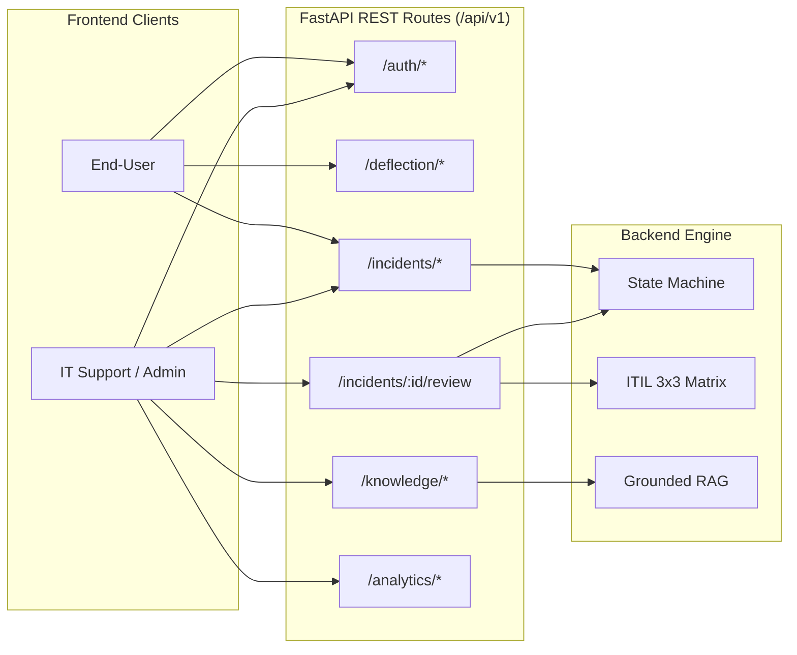

# OPENAPI_SPECIFICATION — IT Incident Triage System
**Specification Version:** OpenAPI 3.1.0  
**Design Status:** VALIDATED & APPROVED (FastAPI 0.111+ Compatible · RESTful · JWT RBAC)  
**Tương thích:** [Swagger UI](https://swagger.io/tools/swagger-ui/), [Redoc](https://redocly.com/redoc/), [Postman Collection](https://www.postman.com/)

Tài liệu đặc tả toàn diện chuẩn giao tiếp **REST API** cho hệ thống **IT Incident Triage System**. Thiết kế tuân thủ nghiêm ngặt nguyên lý RESTful, phân định thẩm quyền RBAC (Role-Based Access Control), chuẩn hóa các mã phản hồi HTTP, định dạng dữ liệu JSON Schema tương thích Pydantic v2, và tích hợp chặt chẽ với mô hình CSDL [DATABASE_DESIGN.md](./DATABASE_DESIGN.md) và kiến trúc [C4_ARCHITECTURE.md](./C4_ARCHITECTURE.md).

---

## I. TỔNG QUAN HẠ TẦNG API (API OVERVIEW)

### 1. Thông tin máy chủ (Base URLs)
* **Local Development:** `http://localhost:8000/api/v1`
* **Staging Server:** `https://staging-api.incident-triage.internal/api/v1`
* **Production:** `https://api.incident-triage.internal/api/v1`

### 2. Chuẩn xác thực & Ủy quyền (Authentication & Authorization)
* **Phương thức:** JSON Web Token (JWT) theo chuẩn RFC 7519.
* **Header bắt buộc đối với Private Routes:**
  ```http
  Authorization: Bearer <access_token>
  ```
* **Thời hạn Token:** Access Token (60 phút), Refresh Token (7 ngày).
* **Phân quyền vai trò (RBAC Scope):**
  * `END_USER`: Chỉ có quyền tạo ticket, nhận AI Deflection, và xem/theo dõi ticket do chính mình tạo (`reporter_id == current_user.id`).
  * `IT_SUPPORT`: Truy cập bàn làm việc Workbench, xem toàn bộ ticket, 1-Click Approve hoặc Override AI Triage, cập nhật tiến độ xử lý và xem Grounded Runbook/SOP.
  * `ADMIN`: Toàn quyền trên mọi tài nguyên, bao gồm xem Dashboard Observability, quản trị người dùng và kiểm toán toàn bộ Audit Logs.

### 3. Chuẩn hóa Định dạng Lỗi (Standard Error Envelope)
Mọi phản hồi lỗi (HTTP $4xx, 5xx$) đều tuân theo chuẩn **RFC 7807 (Problem Details)**:
```json
{
  "error": {
    "code": "VALIDATION_ERROR | UNAUTHORIZED | FORBIDDEN | NOT_FOUND | INVALID_STATE_TRANSITION | AI_SERVICE_TIMEOUT",
    "message": "Thông điệp giải thích lỗi dễ hiểu cho người dùng",
    "details": [
      {
        "field": "impact",
        "issue": "Giá trị phải là một trong các giá trị enum: HIGH, MEDIUM, LOW"
      }
    ],
    "timestamp": "2026-10-30T09:00:00Z",
    "path": "/api/v1/incidents"
  }
}
```

### 4. Chuẩn hóa Phân trang Danh sách (Pagination Envelope)
Áp dụng cho mọi API trả về danh sách:
```json
{
  "items": [],
  "pagination": {
    "total": 128,
    "page": 1,
    "limit": 20,
    "total_pages": 7,
    "has_next": true,
    "has_prev": false
  }
}
```

---

## II. DANH MỤC ENDPOINTS THEO NHÓM CHỨC NĂNG (ENDPOINT MATRIX)

| STT | Phương thức | Endpoint URI | Phân quyền RBAC | Mô tả tóm tắt |
|:---:|:---:|:---|:---:|:---|
| **1. Auth & Session** | | | | |
| 1.1 | `POST` | `/auth/login` | Public | Đăng nhập tài khoản & nhận JWT token |
| 1.2 | `GET` | `/auth/me` | Authenticated | Lấy thông tin phiên và quyền của tài khoản hiện hành |
| 1.3 | `POST` | `/auth/logout` | Authenticated | Đăng xuất và hủy phiên làm việc |
| **2. Self-Service & AI Deflection** | | | | |
| 2.1 | `POST` | `/deflection/suggest` | Authenticated | Gợi ý bài viết giải pháp tức thì khi gõ mô tả (RAG search) |
| 2.2 | `POST` | `/deflection/feedback` | Authenticated | Ghi nhận phản hồi người dùng tự xử lý thành công (không tạo ticket) |
| **3. Incident Management** | | | | |
| 3.1 | `POST` | `/incidents` | Authenticated | Tiếp nhận ticket sự cố mới (< 200ms), kích hoạt Background Worker |
| 3.2 | `GET` | `/incidents` | Authenticated | Danh sách sự cố (Bộ lọc đa chiều, tìm kiếm, phân trang) |
| 3.3 | `GET` | `/incidents/{id}` | Authenticated | Chi tiết sự cố, kết quả AI Triage, RAG Runbook & Lịch sử HITL |
| 3.4 | `PATCH` | `/incidents/{id}/status` | IT_SUPPORT, ADMIN | Chuyển đổi trạng thái vòng đời sự cố (State Machine) |
| **4. Human-in-the-Loop (HITL)** | | | | |
| 4.1 | `POST` | `/incidents/{id}/review` | IT_SUPPORT, ADMIN | 1-Click Approve hoặc Override kết quả AI Triage kèm lý do bắt buộc |
| **5. Grounded RAG & Knowledge** | | | | |
| 5.1 | `GET` | `/knowledge/similar` | IT_SUPPORT, ADMIN | Truy xuất top 3 sự cố tương tự trong quá khứ kèm giải pháp đã chốt |
| 5.2 | `GET` | `/knowledge/runbooks` | IT_SUPPORT, ADMIN | Truy xuất quy trình SOP Runbook và Checklist kiểm tra kỹ thuật |
| **6. Observability & Dashboard** | | | | |
| 6.1 | `GET` | `/analytics/dashboard` | IT_SUPPORT, ADMIN | Lấy số liệu vận hành (P1–P4, SLA, MTTR) & AI Engineering Metrics |
| **7. System Health & Task Status** | | | | |
| 7.1 | `GET` | `/health` | Public | Kiểm tra trạng thái hoạt động API, PostgreSQL và Gemini Service |
| 7.2 | `GET` | `/tasks/{incident_id}` | Authenticated | Kiểm tra trạng thái tiến trình AI Triage ngầm (Polling fallback) |

---

## III. ĐẶC TẢ CHI TIẾT TỪNG ENDPOINT



---

### MODULE 1: AUTHENTICATION & SESSION

#### 1.1 `POST /auth/login`
> Xác thực thông tin tài khoản bằng Email và Mật khẩu, cấp JWT Access Token và thông tin cơ bản của User.

* **Headers:**
  | Header | Giá trị | Bắt buộc |
  |:---|:---|:---:|
  | `Content-Type` | `application/json` | Có |

* **Request Body:**
  ```json
  {
    "email": "support.lead@company.internal",
    "password": "SecurePassword123!"
  }
  ```

* **Responses:**
  * `200 OK` — Đăng nhập thành công:
    ```json
    {
      "access_token": "eyJhbGciOiJIUzI1NiIsInR5cCI6IkpXVCJ9...",
      "token_type": "bearer",
      "expires_in": 3600,
      "user": {
        "id": "a0eebc99-9c0b-4ef8-bb6d-6bb9bd380a11",
        "email": "support.lead@company.internal",
        "full_name": "Nguyễn Văn Hùng",
        "role": "IT_SUPPORT",
        "is_active": true
      }
    }
    ```
  * `401 Unauthorized` — Sai email hoặc mật khẩu.
  * `422 Unprocessable Entity` — Định dạng email không hợp lệ hoặc thiếu mật khẩu.

---

#### 1.2 `GET /auth/me`
> Lấy thông tin tài khoản đang đăng nhập từ JWT Token (dùng cho client khởi tạo state khi reload trang).

* **Headers:**
  | Header | Giá trị | Bắt buộc |
  |:---|:---|:---:|
  | `Authorization` | `Bearer <access_token>` | Có |

* **Responses:**
  * `200 OK`:
    ```json
    {
      "id": "a0eebc99-9c0b-4ef8-bb6d-6bb9bd380a11",
      "email": "support.lead@company.internal",
      "full_name": "Nguyễn Văn Hùng",
      "role": "IT_SUPPORT",
      "is_active": true,
      "created_at": "2026-10-15T08:00:00Z"
    }
    ```
  * `401 Unauthorized` — Token hết hạn hoặc không hợp lệ.

---

### MODULE 2: SELF-SERVICE & AI DEFLECTION

#### 2.1 `POST /deflection/suggest`
> Khi người dùng đang gõ mô tả tại form tạo ticket (client debounce 500ms), API gọi RAG đối soát cơ sở tri thức để gợi ý nhanh các giải pháp tự khắc phục trước khi tạo ticket.

* **Headers:**
  | Header | Giá trị | Bắt buộc |
  |:---|:---|:---:|
  | `Authorization` | `Bearer <access_token>` | Có |
  | `Content-Type` | `application/json` | Có |

* **Request Body:**
  ```json
  {
    "title": "Không thể kết nối VPN công ty từ xa",
    "description": "Tôi mở Cisco AnyConnect nhưng liên tục nhận lỗi 'Gateway unreachable - Error 442'. Đã thử khởi động lại laptop nhưng không được.",
    "affected_service": "VPN Gateway"
  }
  ```

* **Responses:**
  * `200 OK`:
    ```json
    {
      "suggestions": [
        {
          "article_id": "KB-VPN-002",
          "title": "Khắc phục lỗi Cisco AnyConnect: Gateway unreachable (Error 442)",
          "summary": "Lỗi thường do adapter mạng ảo bị khóa hoặc xung đột DNS nội bộ. Thực hiện reset network adapter theo 3 bước sau.",
          "steps": [
            "Mở Device Manager -> Network adapters -> Disable rồi Enable lại 'Cisco AnyConnect Virtual Adapter'.",
            "Mở Terminal/CMD quyền Administrator, chạy lệnh: 'netsh winsock reset'.",
            "Khởi động lại ứng dụng AnyConnect và đăng nhập lại bằng mã OTP."
          ],
          "confidence_score": 0.92,
          "source_url": "https://wiki.company.internal/kb/vpn-error-442"
        }
      ]
    }
    ```

---

#### 2.2 `POST /deflection/feedback`
> Ghi nhận kết quả người dùng tự khắc phục thành công nhờ gợi ý AI (không tạo ticket mới vào CSDL, nhưng ghi nhận metric vào bảng analytics).

* **Request Body:**
  ```json
  {
    "article_id": "KB-VPN-002",
    "search_query": "Không thể kết nối VPN công ty từ xa",
    "is_resolved": true,
    "user_feedback_comment": "Đã làm theo hướng dẫn reset adapter và kết nối lại được ngay."
  }
  ```

* **Responses:**
  * `200 OK`:
    ```json
    {
      "status": "success",
      "message": "Cảm ơn bạn! Sự cố đã được ghi nhận giải quyết tự phục vụ (Self-service Deflected)."
    }
    ```

---

### MODULE 3: INCIDENT MANAGEMENT

#### 3.1 `POST /incidents`
> Tạo sự cố mới. API ghi nhận thông tin vào PostgreSQL với trạng thái `PENDING_TRIAGE`, đẩy task vào `BackgroundTasks` và trả về ngay mã ticket trong vòng $< 200\text{ms}$.

* **Headers:**
  | Header | Giá trị | Bắt buộc |
  |:---|:---|:---:|
  | `Authorization` | `Bearer <access_token>` | Có |
  | `Content-Type` | `application/json` | Có |

* **Request Body:**
  ```json
  {
    "title": "Hệ thống thanh toán qua cổng POS chi nhánh Quận 1 không phản hồi",
    "description": "Toàn bộ máy POS tại quầy thu ngân báo lỗi timeout không kết nối được server trung tâm lúc 14:15. Khách hàng đang ùn ứ tại quầy.",
    "affected_service": "Payment POS Gateway"
  }
  ```

* **Responses:**
  * `201 Created`:
    ```json
    {
      "id": "e7b0c3d4-1a2b-4c5d-8e9f-0a1b2c3d4e5f",
      "incident_number": "INC-2026-0142",
      "title": "Hệ thống thanh toán qua cổng POS chi nhánh Quận 1 không phản hồi",
      "status": "PENDING_TRIAGE",
      "reporter_id": "a0eebc99-9c0b-4ef8-bb6d-6bb9bd380a11",
      "created_at": "2026-10-30T14:15:30Z",
      "message": "Sự cố đã được tiếp nhận thành công. Trợ lý AI đang phân tích và tính toán mức độ ưu tiên."
    }
    ```

---

#### 3.2 `GET /incidents`
> Lấy danh sách sự cố. Hỗ trợ lọc đa tiêu chí, tìm kiếm toàn văn và phân trang. Tự động áp dụng RBAC: End-User chỉ nhận danh sách sự cố do mình tạo; IT Support và Admin nhận toàn bộ sự cố hệ thống.

* **Query Parameters:**
  | Tham số | Kiểu dữ liệu | Mặc định | Mô tả |
  |:---|:---|:---:|:---|
  | `page` | `integer` | `1` | Trang hiện tại (tối thiểu: 1) |
  | `limit` | `integer` | `20` | Số lượng phần tử mỗi trang (1 – 100) |
  | `status` | `string` | — | Lọc theo trạng thái: `PENDING_TRIAGE`, `AI_SUGGESTED`, `MANUAL_TRIAGE_REQUIRED`, `TRIAGED`, `IN_PROGRESS`, `RESOLVED`, `CLOSED` |
  | `priority` | `string` | — | Lọc theo độ ưu tiên: `P1`, `P2`, `P3`, `P4` |
  | `category` | `string` | — | Lọc theo danh mục sự cố: `Hardware`, `Software`, `Network`, `Security`, `Access` |
  | `is_dlq` | `boolean` | — | Lọc các ticket bị lỗi AI Worker cần triage thủ công |
  | `search` | `string` | — | Tìm kiếm theo mã sự cố (`INC-xxxx`) hoặc từ khóa tiêu đề |
  | `sort_by` | `string` | `created_at` | Trường sắp xếp (`created_at`, `priority`, `sla_response_deadline`) |
  | `order` | `string` | `desc` | Thứ tự sắp xếp: `asc` hoặc `desc` |

* **Responses:**
  * `200 OK`:
    ```json
    {
      "items": [
        {
          "id": "e7b0c3d4-1a2b-4c5d-8e9f-0a1b2c3d4e5f",
          "incident_number": "INC-2026-0142",
          "title": "Hệ thống thanh toán qua cổng POS chi nhánh Quận 1 không phản hồi",
          "affected_service": "Payment POS Gateway",
          "status": "AI_SUGGESTED",
          "category": "Software",
          "impact": "HIGH",
          "urgency": "HIGH",
          "priority": "P1",
          "reporter": {
            "id": "a0eebc99-9c0b-4ef8-bb6d-6bb9bd380a11",
            "full_name": "Trần Thị Mai",
            "email": "mai.tran@company.internal"
          },
          "assignee": null,
          "ai_triage": {
            "suggested_category": "Software",
            "suggested_priority": "P1",
            "confidence_score": 0.94,
            "has_missing_info": false
          },
          "sla_response_deadline": "2026-10-30T14:30:30Z",
          "sla_resolution_deadline": "2026-10-30T15:15:30Z",
          "is_dlq": false,
          "created_at": "2026-10-30T14:15:30Z"
        }
      ],
      "pagination": {
        "total": 42,
        "page": 1,
        "limit": 20,
        "total_pages": 3,
        "has_next": true,
        "has_prev": false
      }
    }
    ```

---

#### 3.3 `GET /incidents/{id}`
> Lấy toàn bộ thông tin chi tiết một sự cố: dữ liệu ban đầu, kết quả phân tích AI Triage chuyên sâu, gợi ý giải pháp Runbook RAG, và toàn bộ lịch sử thẩm định con người (HITL Review & Audit Logs).

* **Responses:**
  * `200 OK`:
    ```json
    {
      "id": "e7b0c3d4-1a2b-4c5d-8e9f-0a1b2c3d4e5f",
      "incident_number": "INC-2026-0142",
      "title": "Hệ thống thanh toán qua cổng POS chi nhánh Quận 1 không phản hồi",
      "description": "Toàn bộ máy POS tại quầy thu ngân báo lỗi timeout không kết nối được server trung tâm lúc 14:15. Khách hàng đang ùn ứ tại quầy.",
      "affected_service": "Payment POS Gateway",
      "status": "AI_SUGGESTED",
      "category": "Software",
      "impact": "HIGH",
      "urgency": "HIGH",
      "priority": "P1",
      "sla_response_deadline": "2026-10-30T14:30:30Z",
      "sla_resolution_deadline": "2026-10-30T15:15:30Z",
      "reporter": {
        "id": "a0eebc99-9c0b-4ef8-bb6d-6bb9bd380a11",
        "full_name": "Trần Thị Mai",
        "email": "mai.tran@company.internal"
      },
      "assignee": {
        "id": "b1ffcd88-8d0a-4fe7-aa5c-5aa8ac270b22",
        "full_name": "Lê Hoàng Đức",
        "email": "duc.le@company.internal"
      },
      "ai_triage_result": {
        "id": "f8c1d2e3-2b3c-4d5e-9f0a-1b2c3d4e5f60",
        "suggested_category": "Software",
        "suggested_impact": "HIGH",
        "suggested_urgency": "HIGH",
        "suggested_priority": "P1",
        "confidence_score": 0.94,
        "reasoning": "Sự cố làm tê liệt hoàn toàn chức năng thanh toán tại quầy chi nhánh, ảnh hưởng diện rộng tới nhiều khách hàng trực tiếp tại quầy trong giờ cao điểm -> Impact HIGH. Không có phương án thay thế khả thi tức thời -> Urgency HIGH. Áp dụng ma trận ITIL 3x3: HIGH x HIGH = P1 (Nghiêm trọng).",
        "missing_info": {
          "is_missing": false,
          "missing_fields": [],
          "suggested_inquiry": null
        },
        "model_name": "gemini-1.5-flash",
        "created_at": "2026-10-30T14:15:32Z"
      },
      "review": null,
      "created_at": "2026-10-30T14:15:30Z",
      "updated_at": "2026-10-30T14:15:32Z"
    }
    ```
  * `403 Forbidden` — End-User cố tình xem ticket của người khác.
  * `404 Not Found` — Không tìm thấy mã sự cố.

---

#### 3.4 `PATCH /incidents/{id}/status`
> Cập nhật trạng thái tiến độ xử lý sự cố. Kiểm soát chặt chẽ bởi **Incident State Machine** (ngăn chặn chuyển trạng thái nhảy cóc). Bắt buộc nhập `resolution_notes` khi chuyển sang `RESOLVED`.

* **Phân quyền:** `IT_SUPPORT`, `ADMIN`.
* **Request Body:**
  ```json
  {
    "status": "RESOLVED",
    "note": "Đã khởi động lại dịch vụ Transaction Proxy Daemon trên server Gateway và thông tuyến thành công.",
    "resolution_summary": "Khởi động lại tiến trình POS-Proxy service trên cụm POS-GW-01. Kiểm tra lại 5 giao dịch mẫu đạt thành công 100%."
  }
  ```

* **Quy tắc chuyển đổi trạng thái hợp lệ:**
  * `PENDING_TRIAGE` $\rightarrow$ `AI_SUGGESTED` hoặc `MANUAL_TRIAGE_REQUIRED`
  * `AI_SUGGESTED` / `MANUAL_TRIAGE_REQUIRED` $\rightarrow$ `TRIAGED` (thông qua review)
  * `TRIAGED` $\rightarrow$ `IN_PROGRESS`
  * `IN_PROGRESS` $\rightarrow$ `RESOLVED` (bắt buộc `resolution_summary`)
  * `RESOLVED` $\rightarrow$ `CLOSED`

* **Responses:**
  * `200 OK`:
    ```json
    {
      "id": "e7b0c3d4-1a2b-4c5d-8e9f-0a1b2c3d4e5f",
      "status": "RESOLVED",
      "resolved_at": "2026-10-30T14:55:00Z",
      "message": "Trạng thái sự cố đã được cập nhật thành công sang RESOLVED."
    }
    ```
  * `400 Bad Request` — Chuyển trạng thái vi phạm State Machine hoặc thiếu `resolution_summary` khi RESOLVED.

---

### MODULE 4: HUMAN-IN-THE-LOOP (HITL)

#### 4.1 `POST /incidents/{id}/review`
> Kỹ thuật viên L1/L2 thẩm định kết quả phân loại của AI. Hỗ trợ 2 kịch bản:
> 1. **1-Click Approve:** Chấp nhận toàn bộ đề xuất của AI (`accepted_ai_suggestion: true`).
> 2. **Human Override:** Điều chỉnh lại Danh mục hoặc Priority (`accepted_ai_suggestion: false`). Bắt buộc phải cung cấp trường `override_reason`.

* **Phân quyền:** `IT_SUPPORT`, `ADMIN`.
* **Request Body (Kịch bản 1: 1-Click Approve):**
  ```json
  {
    "accepted_ai_suggestion": true
  }
  ```

* **Request Body (Kịch bản 2: Human Override):**
  ```json
  {
    "accepted_ai_suggestion": false,
    "final_category": "Hardware",
    "final_priority": "P2",
    "override_reason": "Sau khi kỹ thuật viên gọi điện kiểm tra, chỉ có 1 trong 4 máy POS bị lỗi nguồn lỏng dây cắm, 3 máy còn lại vẫn thanh toán bình thường nên hạ từ P1 xuống P2."
  }
  ```

* **Responses:**
  * `200 OK`:
    ```json
    {
      "review_id": "c2dd3e4f-5a6b-7c8d-9e0f-1a2b3c4d5e6f",
      "incident_id": "e7b0c3d4-1a2b-4c5d-8e9f-0a1b2c3d4e5f",
      "status": "TRIAGED",
      "accepted_ai_suggestion": false,
      "final_category": "Hardware",
      "final_priority": "P2",
      "is_human_override": true,
      "override_reason": "Sau khi kỹ thuật viên gọi điện kiểm tra...",
      "reviewer": {
        "id": "b1ffcd88-8d0a-4fe7-aa5c-5aa8ac270b22",
        "full_name": "Lê Hoàng Đức"
      },
      "reviewed_at": "2026-10-30T14:22:15Z"
    }
    ```
  * `422 Unprocessable Entity` — Khi `accepted_ai_suggestion == false` nhưng bỏ trống `override_reason` hoặc lý do dưới 10 ký tự.

---

### MODULE 5: GROUNDED RAG & KNOWLEDGE SERVICE

#### 5.1 `GET /knowledge/similar`
> Truy xuất top 3 sự cố tương tự trong quá khứ đã được giải quyết thành công (sử dụng PostgreSQL Full-Text Search / Vector Similarity).

* **Query Parameters:**
  | Tham số | Kiểu dữ liệu | Bắt buộc | Mô tả |
  |:---|:---|:---:|:---|
  | `incident_id` | `uuid` | Có | ID sự cố đang điều tra |
  | `limit` | `integer` | Không (mặc định: 3) | Số lượng sự cố tương tự cần lấy |

* **Responses:**
  * `200 OK`:
    ```json
    {
      "similar_incidents": [
        {
          "incident_number": "INC-2026-0089",
          "title": "Cổng kết nối POS chi nhánh Bình Thạnh mất tín hiệu",
          "category": "Software",
          "priority": "P2",
          "resolved_at": "2026-09-12T10:30:00Z",
          "similarity_score": 0.88,
          "solution": "Khởi động lại router mạng phụ và cấp lại chứng chỉ SSL cho máy POS."
        }
      ]
    }
    ```

---

#### 5.2 `GET /knowledge/runbooks`
> Truy xuất quy trình thao tác chuẩn (SOP Runbook) tương ứng với danh mục sự cố và dịch vụ bị ảnh hưởng.

* **Query Parameters:**
  | Tham số | Kiểu dữ liệu | Bắt buộc | Mô tả |
  |:---|:---|:---:|:---|
  | `category` | `string` | Có | Danh mục sự cố (`Software`, `Network`...) |
  | `affected_service` | `string` | Không | Tên dịch vụ bị lỗi |

* **Responses:**
  * `200 OK`:
    ```json
    {
      "runbook_id": "SOP-POS-01",
      "title": "Quy trình ứng cứu sự cố hệ thống thanh toán POS",
      "source_document": "SOP_POS_Gateway_Troubleshooting_v2.1.pdf",
      "checklist": [
        {
          "step": 1,
          "task": "Kiểm tra trạng thái kết nối mạng qua lệnh ping tới gateway nội bộ.",
          "required": true
        },
        {
          "step": 2,
          "task": "Xác nhận logs trên POS Terminal xem có mã lỗi HTTP 504 Gateway Timeout không.",
          "required": true
        },
        {
          "step": 3,
          "task": "Chuyển tạm thời luồng quầy sang máy POS dự phòng số 4.",
          "required": false
        }
      ]
    }
    ```

---

### MODULE 6: OBSERVABILITY & DASHBOARD

#### 6.1 `GET /analytics/dashboard`
> Trả về toàn bộ số liệu thống kê vận hành (Operational KPIs) và chỉ số chất lượng mô hình AI (AI Engineering Metrics) theo thời gian thực.

* **Phân quyền:** `IT_SUPPORT`, `ADMIN`.
* **Query Parameters:**
  | Tham số | Kiểu | Mặc định | Mô tả |
  |:---|:---|:---:|:---|
  | `time_range` | `string` | `7d` | Khoảng thời gian: `24h`, `7d`, `30d`, `all` |

* **Responses:**
  * `200 OK`:
    ```json
    {
      "operational_metrics": {
        "total_incidents": 154,
        "priority_distribution": {
          "P1": 12,
          "P2": 38,
          "P3": 64,
          "P4": 40
        },
        "sla_compliance_rate": 96.8,
        "sla_breached_count": 5,
        "mean_time_to_resolve_minutes": 42.5
      },
      "ai_engineering_metrics": {
        "deflection_rate": 38.5,
        "deflected_count": 96,
        "ai_accuracy_rate": 84.6,
        "human_override_rate": 15.4,
        "override_breakdown_by_category": {
          "Hardware": 21.0,
          "Software": 12.5,
          "Network": 14.2,
          "Security": 8.0,
          "Access": 5.1
        },
        "avg_worker_latency_ms": 1120,
        "dlq_fallback_rate": 1.2
      }
    }
    ```

---

### MODULE 7: SYSTEM HEALTH & TASK MONITORING

#### 7.1 `GET /health`
> Kiểm tra sức khỏe của API server và các kết nối phụ thuộc (PostgreSQL, Gemini API).

* **Responses:**
  * `200 OK`:
    ```json
    {
      "status": "HEALTHY",
      "version": "1.0.0",
      "timestamp": "2026-10-30T16:20:00Z",
      "components": {
        "database": "CONNECTED",
        "gemini_api": "REACHABLE",
        "queue_worker": "ACTIVE"
      }
    }
    ```

---

#### 7.2 `GET /tasks/{incident_id}`
> Kiểm tra trạng thái xử lý tác vụ AI Triage ngầm trong trường hợp client cần thăm dò (polling).

* **Responses:**
  * `200 OK`:
    ```json
    {
      "incident_id": "e7b0c3d4-1a2b-4c5d-8e9f-0a1b2c3d4e5f",
      "task_type": "AI_TRIAGE",
      "status": "COMPLETED",
      "attempts": 1,
      "max_attempts": 3,
      "error_message": null,
      "updated_at": "2026-10-30T14:15:32Z"
    }
    ```
