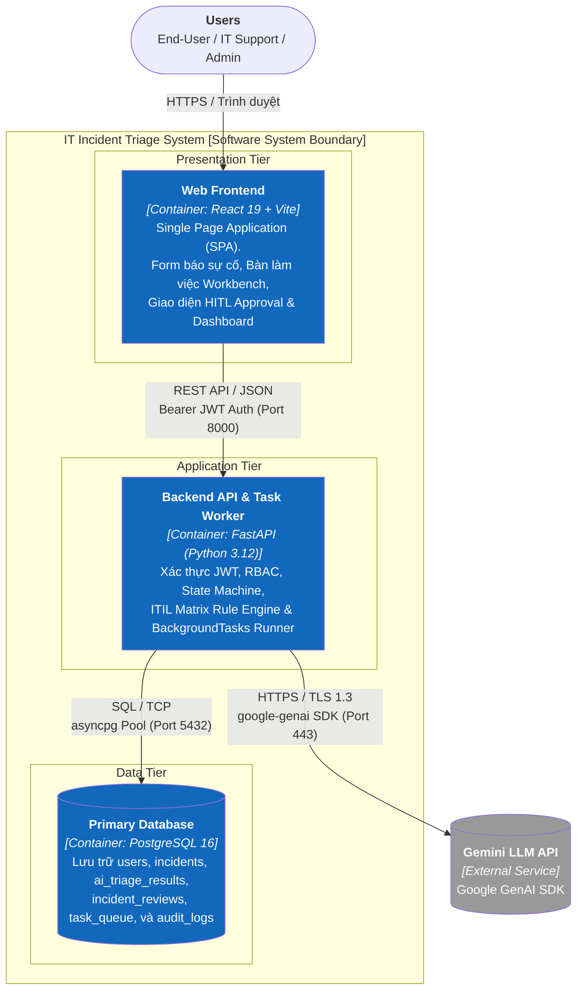

# 02-CONTAINER — Container Diagram (C2)
**Architecture Level:** C4 Level 2 (Containers)  
**System Boundary:** IT Incident Triage System  
**Status:** VALIDATED & APPROVED

Tài liệu đặc tả các đơn vị thực thi/triển khai độc lập (Containers), công nghệ sử dụng, giao thức truyền thông liên container và nguyên lý kiến trúc tinh gọn (Lean Architecture).

---

## I. SƠ ĐỒ CONTAINER TỔNG THỂ (C2 DIAGRAM)

---

## II. DANH MỤC CONTAINERS CHI TIẾT

### 1. Web Frontend (Presentation Container)
* **Loại Container:** Single Page Application (SPA).
* **Công nghệ chủ đạo:** React 19, Vite, Vanilla CSS hiện đại, React Router v6.
* **Nhiệm vụ chính:**
  * Cung cấp giao diện đáp ứng (responsive), trực quan cho 3 nhóm đối tượng: End-User, IT Support, Administrator.
  * Tích hợp cơ chế **Smart Deflection**: Gửi request debounce khi người dùng gõ mô tả để hiển thị tức thời bài viết tự khắc phục.
  * Cung cấp bảng điều khiển **IT Support Workbench** với bộ lọc đa chiều (Category, Priority P1–P4, Trạng thái, Cờ DLQ).
  * Hỗ trợ giao diện **Human-in-the-Loop Review**: 1-Click Approve hoặc Form Override (đổi danh mục/ưu tiên kèm lý do bắt buộc).
  * Hiển thị bảng điều khiển **Observability Dashboard** với các biểu đồ SLA compliance, MTTR và tỷ lệ can thiệp AI.
* **Giao tiếp:** Gọi REST API tới Backend qua giao thức HTTPS/JSON kèm header `Authorization: Bearer <token>`.

### 2. Backend API & Task Worker (Application Container)
* **Loại Container:** Web API Server kiêm In-process Asynchronous Task Runner.
* **Công nghệ chủ đạo:** Python 3.12, FastAPI 0.111+, Pydantic v2, SQLAlchemy 2.0 (Async), `asyncpg`.
* **Nhiệm vụ chính:**
  * **Cổng tiếp nhận HTTP:** Kiểm tra tính hợp lệ dữ liệu (Pydantic validation), xác thực JWT và thực thi phân quyền RBAC.
  * **Tiếp nhận tức thời (< 200ms):** Lưu ticket vào PostgreSQL với trạng thái `PENDING_TRIAGE`, sau đó kích hoạt task ngầm thông qua FastAPI `BackgroundTasks`.
  * **Worker xử lý ngầm (Asynchronous Runner):** Gọi Gemini LLM API trích xuất dữ kiện thô, đối chiếu ma trận ITIL 3×3, cập nhật ticket sang `AI_SUGGESTED`.
  * **Quản trị vòng đời (Incident State Machine):** Ràng buộc quy tắc chuyển trạng thái hợp lệ giữa các bước, yêu cầu nhập tóm tắt giải pháp khi `RESOLVED`.
  * **Cơ chế chịu lỗi (Fault-tolerance):** Retry tối đa 3 lần với Exponential Backoff (2s, 6s); nếu quá số lần, đưa vào Dead-Letter Queue (`MANUAL_TRIAGE_REQUIRED`).
* **Giao tiếp:** Nhận request từ Frontend (port 8000), truy vấn PostgreSQL (port 5432), gọi Gemini API (port 443).

### 3. Primary Database (Data Persistence Container)
* **Loại Container:** Hệ quản trị cơ sở dữ liệu quan hệ (RDBMS).
* **Công nghệ chủ đạo:** PostgreSQL 16.
* **Nhiệm vụ chính:**
  * Lưu trữ bền vững toàn bộ dữ liệu nghiệp vụ: `users`, `incidents`, `ai_triage_results`, `incident_reviews`, `incident_status_history`, `audit_logs`, `task_queue`.
  * Phân tách nghiêm ngặt giữa dữ liệu AI đề xuất và quyết định chính thức của con người.
  * Hỗ trợ tìm kiếm toàn văn (PostgreSQL Full-Text Search / GIN Index) phục vụ truy xuất sự cố tương tự và bài viết Runbook.
  * Bảng `task_queue` hoạt động như một state storage cho hàng đợi công việc nền, hỗ trợ tracking số lần retry và lỗi DLQ.

---

## III. MA TRẬN KẾT NỐI LIÊN CONTAINER (CONTAINER PROTOCOL MATRIX)

| Nguồn | Đích | Giao thức | Cổng (Port) | Dữ liệu truyền | Bảo mật & Xác thực |
|:---|:---|:---|:---:|:---|:---|
| **Trình duyệt Client** | Web Frontend | HTTPS | 443 / 80 | Static Assets (HTML, JS, CSS, Media) | TLS 1.3 |
| **Web Frontend** | Backend API | HTTP/REST | 8000 | JSON Payloads (CRUD, Review, Status) | JWT Bearer Token |
| **Backend API** | PostgreSQL | PostgreSQL TCP | 5432 | SQL Statements, Async connection pool | Username/Password, SSL mode |
| **Backend API** | Gemini LLM API | HTTPS REST | 443 | JSON Prompt, Structured Schema output | API Key (`GEMINI_API_KEY`) |

---

## IV. QUYẾT ĐỊNH THIẾT KẾ KIẾN TRÚC TINH GỌN (LEAN ARCHITECTURE / KISS / YAGNI)

> **Quyết định:** Không sử dụng hàng đợi độc lập ngoài (Redis / RabbitMQ / Celery) trong phiên bản này.

### Lý do lựa chọn:
1. **Tránh over-engineering:** Với quy mô hệ thống mục tiêu tiếp nhận hàng nghìn ticket/ngày trong doanh nghiệp, FastAPI `BackgroundTasks` kết hợp bảng `task_queue` trong PostgreSQL là giải pháp đơn giản, hiệu quả, đáp ứng trọn vẹn SLA phản hồi $< 200\text{ms}$.
2. **Đảm bảo tính nhất quán dữ liệu (ACID):** Việc cập nhật trạng thái sự cố và trạng thái hàng đợi nằm chung trong một cơ sở dữ liệu PostgreSQL giúp tránh rủi ro mất đồng bộ trạng thái giữa DB và Message Broker.
3. **Tiết kiệm tài nguyên và đơn giản hóa vận hành:** Giảm thiểu 1 container phụ thuộc, giảm độ phức tạp khi deploy trên môi trường local, Docker Compose hoặc CI/CD pipeline.
