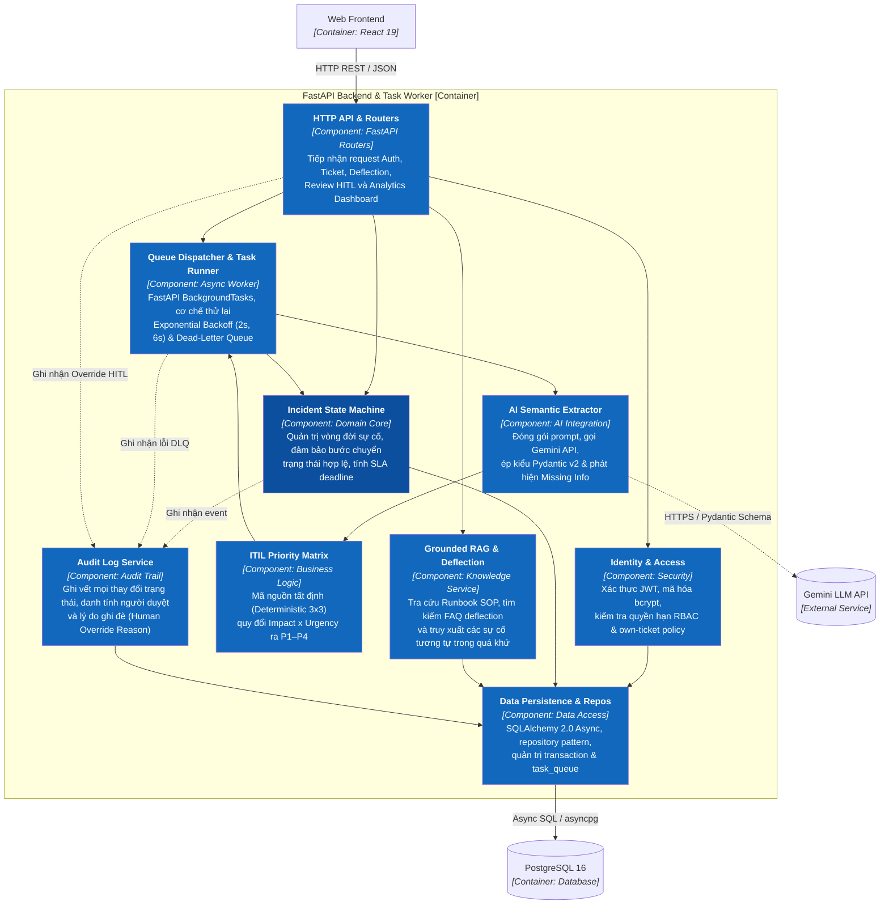

# 03-COMPONENT — Component Diagram (C3)
**Architecture Level:** C4 Level 3 (Components)  
**Container:** Backend API & Task Worker (FastAPI Application)  
**Status:** VALIDATED & APPROVED

Tài liệu bóc tách chi tiết các module/component phần mềm bên trong container **Backend API & Task Worker**, phân định ranh giới trách nhiệm và phương thức giao tiếp giữa các thành phần.

---

## I. SƠ ĐỒ COMPONENT TỔNG THỂ (C3 DIAGRAM)



---

## II. BẢNG PHÂN NHIỆM CHI TIẾT TỪNG COMPONENT

| Tên Component | Phân loại | Công nghệ / Thư viện | Nhiệm vụ chính & Ranh giới trách nhiệm |
|:---|:---|:---|:---|
| **1. HTTP API & Routers** | Presentation Interface | `fastapi.APIRouter` | Tiếp nhận và định tuyến các request từ Web Frontend; kiểm tra tính hợp lệ dữ liệu đầu vào thông qua Pydantic schemas; trả về response JSON chuẩn hóa và mã lỗi RFC 7807. |
| **2. Identity & Access** | Security & Auth | `python-jose`, `passlib[bcrypt]` | Cấp phát và giải mã JWT token; kiểm tra quyền hạn tài khoản theo ma trận RBAC (`END_USER`, `IT_SUPPORT`, `ADMIN`); thực thi chính sách bảo mật dữ liệu "chỉ xem ticket của chính mình" đối với End-User. |
| **3. Incident State Machine** | Domain Core Logic | Pure Python Class | Kiểm soát chặt chẽ trạng thái vòng đời sự cố (ngăn chặn thao tác nhảy cóc); tự động tính toán thời hạn SLA phản hồi và xử lý theo chuẩn ITIL; yêu cầu bắt buộc nhập tóm tắt giải pháp khi chuyển sang `RESOLVED`. |
| **4. Queue Dispatcher & Task Runner** | Asynchronous Processing | FastAPI `BackgroundTasks` | Tiếp nhận ticket ID ngay sau khi tạo, khởi chạy tác vụ gọi AI ngầm; điều phối số lần thử lại (tối đa 3 lần với Exponential Backoff); tự động đưa vào Dead-Letter Queue (`MANUAL_TRIAGE_REQUIRED`) nếu lỗi kéo dài. |
| **5. AI Semantic Extractor** | AI Integration Service | `google-genai`, Pydantic v2 | Đóng gói Prompt hệ thống; gọi Gemini API với cấu trúc ép kiểu nghiêm ngặt để bóc tách: Danh mục, Tác động (Impact), Khẩn cấp (Urgency), Độ tin cậy (Confidence Score), và Phát hiện thông tin kỹ thuật còn thiếu (`missing_info`). |
| **6. ITIL Priority Matrix** | Business Rules Engine | Pure Python (Deterministic) | Thực thi ma trận cứng $3 \times 3$ giữa Tác động và Khẩn cấp để xác định mức ưu tiên P1–P4; tự động bật cờ cảnh báo `is_critical` nếu là P1. Tuyệt đối không để LLM tự do đoán mò mức độ ưu tiên. |
| **7. Grounded RAG & Deflection** | Knowledge Service | Domain Service + PostgreSQL FTS | Tìm kiếm bài viết FAQ/Runbook hỗ trợ người dùng tự khắc phục (Deflection) và truy xuất top 3 sự cố tương tự trong quá khứ đã được giải quyết kèm quy trình Runbook nội bộ phục vụ kỹ thuật viên L1/L2. |
| **8. Audit Log Service** | Observability & Audit Trail | Python Service | Tự động ghi lại lịch sử mọi hành động nghiệp vụ vào bảng `audit_logs`: người thực hiện, thời điểm, trạng thái cũ/mới, kết quả AI đề xuất, và lý do ghi đè của con người (`override_reason`). |
| **9. Data Persistence & Repositories** | Data Access Layer | SQLAlchemy 2.0 (Async), `asyncpg` | Quản lý kết nối connection pool tới PostgreSQL; triển khai mẫu thiết kế Repository Pattern cho các thực thể; quản lý transaction phân tán và theo dõi tiến trình hàng đợi trong bảng `task_queue`. |

---

## III. MA TRẬN TƯƠNG TÁC GIỮA CÁC COMPONENT (INTER-COMPONENT FLOW)

### 1. Luồng tiếp nhận sự cố & Triage nền (< 200ms)
```
Client Request 
   ↳ [HTTP API & Routers]
        ↳ Kiểm tra schema & phân quyền [Identity & Access]
        ↳ Lưu ticket (Status: PENDING_TRIAGE) [Persistence]
        ↳ Kích hoạt BackgroundTask [Queue Dispatcher]
        ↳ Trả về response 201 Created cho Client (< 200ms)
             ⋮ (Chạy nền)
             ↳ [Queue Dispatcher] gọi [AI Semantic Extractor]
                  ↳ Gọi Gemini API -> Trả về JSON (Category, Impact, Urgency)
                  ↳ Gọi [ITIL Priority Matrix] đối chiếu -> Ra P1-P4
                  ↳ Gọi [Incident State Machine] -> Cập nhật Status: AI_SUGGESTED
                  ↳ Lưu kết quả AI vào DB [Persistence]
```

### 2. Luồng thẩm định Human-in-the-Loop (HITL)
```
IT Support Click [Approve / Override]
   ↳ [HTTP API & Routers]
        ↳ Kiểm tra role IT_SUPPORT [Identity & Access]
        ↳ Gọi [Incident State Machine] xác nhận chuyển sang TRIAGED
        ↳ Ghi nhận vào [Audit Log Service] (kèm override_reason nếu sửa kết quả AI)
        ↳ Lưu bản ghi incident_reviews [Persistence]
        ↳ Trả về response 200 OK cho Web Frontend
```
