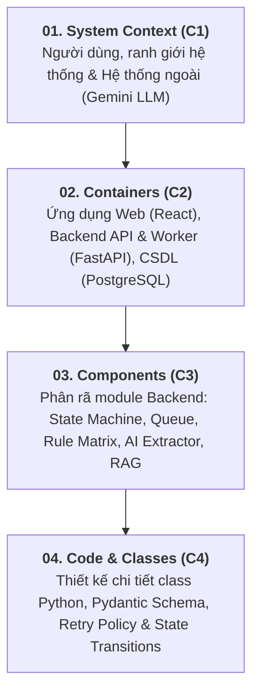

# C4 Architecture Model — IT Incident Triage System
**Architecture Framework:** Simon Brown C4 Model (Context, Container, Component, Code)  
**Status:** VALIDATED & APPROVED  
**Hệ thống:** IT Incident Triage & Deflection System

---

##  GIỚI THIỆU TỔNG QUAN

Tài liệu kiến trúc hệ thống được cấu trúc theo mô hình **C4 Model** (Context, Container, Component, Code), giúp phân rã kiến trúc phức tạp của giải pháp **IT Incident Triage System** thành 4 cấp độ trực quan với độ chi tiết tăng dần:

---

##  DANH MỤC TÀI LIỆU C4 THEO CẤP ĐỘ

| Cấp độ | Tài liệu | Đối tượng người đọc | Nội dung chính |
|:---|:---|:---|:---|
| **C1** | [01-CONTEXT.md](./01-CONTEXT.md) | Stakeholders, PM, Architect | Hệ thống giải quyết bài toán gì, ai sử dụng (Personas), kết nối với hệ thống ngoài nào. |
| **C2** | [02-CONTAINER.md](./02-CONTAINER.md) | DevOps, System Architect, Tech Lead | Các đơn vị triển khai độc lập (Frontend, Backend, Database), giao thức kết nối & kiến trúc tinh gọn (KISS/YAGNI). |
| **C3** | [03-COMPONENT.md](./03-COMPONENT.md) | Backend Engineers, AI Engineers | Bóc tách 9 module nội bộ trong container FastAPI: State Machine, Hàng đợi nền, Ma trận ITIL, Grounded RAG. |
| **C4** | [04-CODE.md](./04-CODE.md) | Software Engineers, Code Reviewers | Thiết kế class Python, State Machine pattern, thuật toán ma trận 3x3, Pydantic schemas *(Trạng thái:  Đang triển khai)* |

---

##  CÁC NGUYÊN TẮC THIẾT KẾ CỐT LÕI (ARCHITECTURAL DRIVERS)

1. **Hiệu năng tiếp nhận (< 200ms):**
   - Tách biệt luồng nhận ticket khỏi luồng phân tích AI thông qua `BackgroundTasks` ngay trong FastAPI.
   - Trả về mã ticket `INC-xxxx` tức thì cho người dùng.

2. **Quy tắc ITIL 3×3 Tất định (Deterministic Rules):**
   - LLM chỉ trích xuất dữ kiện ngữ nghĩa thô (`Impact`, `Urgency`, `Category`, `Missing Info`).
   - Việc quy đổi ra mức ưu tiên `P1`–`P4` do mã nguồn backend đảm nhiệm tra bảng cứng $3 \times 3$, đảm bảo 100% minh bạch và không bị hallucination.

3. **Kiểm soát con người (Human-in-the-Loop - HITL):**
   - Kỹ thuật viên L1/L2 có quyền 1-Click Approve hoặc Override (đổi danh mục / độ ưu tiên, bắt buộc nhập lý do).
   - Tách biệt dữ liệu đề xuất của AI (`ai_suggested_priority`) và quyết định chính thức (`final_priority`).

4. **Khả năng chịu lỗi & Dead-Letter Queue (DLQ):**
   - Tự động thử lại tối đa 3 lần với Exponential Backoff (2s, 6s) khi LLM quá tải hoặc timeout.
   - Nếu quá số lần cho phép, chuyển ticket vào trạng thái `MANUAL_TRIAGE_REQUIRED` để kỹ thuật viên xử lý thủ công, không làm thất lạc yêu cầu của người dùng.
