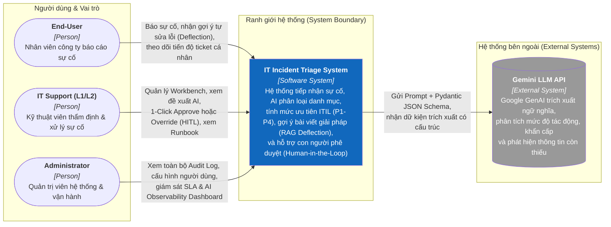
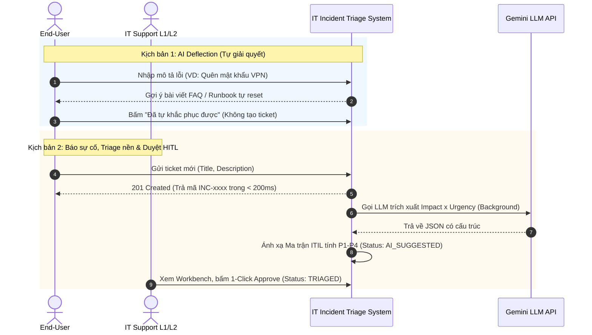

# 01-CONTEXT — System Context Diagram (C1)
**Architecture Level:** C4 Level 1 (System Context)  
**System Boundary:** IT Incident Triage & Deflection System  
**Status:** VALIDATED & APPROVED

Tài liệu xác định phạm vi ranh giới hệ thống ở mức cao nhất, các nhóm tác nhân người dùng (Personas) tương tác với hệ thống, và các hệ thống bên ngoài (External Systems) mà giải pháp tích hợp.

---

## I. SƠ ĐỒ BỐI CẢNH HỆ THỐNG (C1 DIAGRAM)

---

## II. ĐẶC TẢ TÁC NHÂN NGƯỜI DÙNG (PERSONAS)

### 1. End-User (Nhân viên công ty)
* **Bối cảnh:** Nhân viên các phòng ban gặp sự cố kỹ thuật (máy in không kết nối, lỗi phần mềm kế toán, mất kết nối VPN, quên mật khẩu máy trạm...).
* **Mục tiêu:**
  * Báo cáo sự cố nhanh gọn, không cần hiểu sâu thuật ngữ kỹ thuật ITIL.
  * Tự khắc phục nhanh thông qua gợi ý giải pháp tức thì (**AI Deflection**) để tiếp tục công việc ngay lập tức.
  * Theo dõi tiến độ xử lý và cam kết thời gian hoàn thành (SLA) minh bạch.
* **Quyền hạn hệ thống:** Chỉ có quyền tạo ticket và xem các ticket do chính mình tạo.

### 2. IT Support L1/L2 (Kỹ thuật viên Hỗ trợ Kỹ thuật)
* **Bối cảnh:** Nhận hàng trăm yêu cầu mỗi ngày, đối mặt với các ticket mô tả sơ sài, người dùng thường thổi phồng mức độ ưu tiên lên cao nhất.
* **Mục tiêu:**
  * Không mất thời gian đọc thủ công để phân loại danh mục và độ ưu tiên.
  * Nhận diện ngay các thông tin kỹ thuật còn thiếu (`missing_info`) để yêu cầu bổ sung trước khi điều tra.
  * Nhanh chóng đưa ra quyết định bằng **1-Click Approve** hoặc **Override** kèm lý do nghiệp vụ.
  * Xem ngay các sự cố tương tự trong quá khứ đã được giải quyết kèm quy trình chuẩn (**Runbook SOP**).
* **Quyền hạn hệ thống:** Xem toàn bộ ticket trên Workbench, thẩm định kết quả AI, chuyển đổi trạng thái xử lý sự cố.

### 3. Administrator (Quản trị viên Hệ thống)
* **Bối cảnh:** Chịu trách nhiệm về chất lượng dịch vụ CNTT toàn công ty và hiệu quả ứng dụng AI.
* **Mục tiêu:**
  * Giám sát thời gian thực các chỉ số cam kết SLA (P1: phản hồi 15p, xử lý 1h; P2: phản hồi 30p, xử lý 4h...).
  * Đo lường hiệu quả AI: Tỷ lệ tự phục vụ thành công (**Deflection Rate**), Tỷ lệ con người phải can thiệp sửa AI (**Human Override Rate**), Tỷ lệ lỗi hàng đợi (**DLQ Fallback Rate**).
  * Tra cứu vết kiểm toán (**Audit Logs**) nhằm phục vụ tuân thủ quy trình an toàn thông tin nội bộ.
* **Quyền hạn hệ thống:** Toàn quyền cấu hình, quản lý tài khoản và truy cập Dashboard tổng thể.

---

## III. HỆ THỐNG PHỤ THUỘC BÊN NGOÀI (EXTERNAL DEPENDENCIES)

| Tên hệ thống | Nhà cung cấp | Giao thức | Mục đích tích hợp | Chiến lược dự phòng (Fallback) |
|:---|:---|:---|:---|:---|
| **Gemini LLM API** | Google Cloud / Google AI Studio | HTTPS REST (`google-genai` SDK) | Trích xuất ngữ nghĩa (`Category`, `Impact`, `Urgency`, `Missing Info`) ép kiểu qua Pydantic v2. | Thử lại tối đa 3 lần với Exponential Backoff (2s, 6s); nếu quá số lần, chuyển sang Dead-Letter Queue (`MANUAL_TRIAGE_REQUIRED`). |

---

## IV. CÁC HÀNH TRÌNH TƯƠNG TÁC CHÍNH (KEY USER JOURNEYS)

