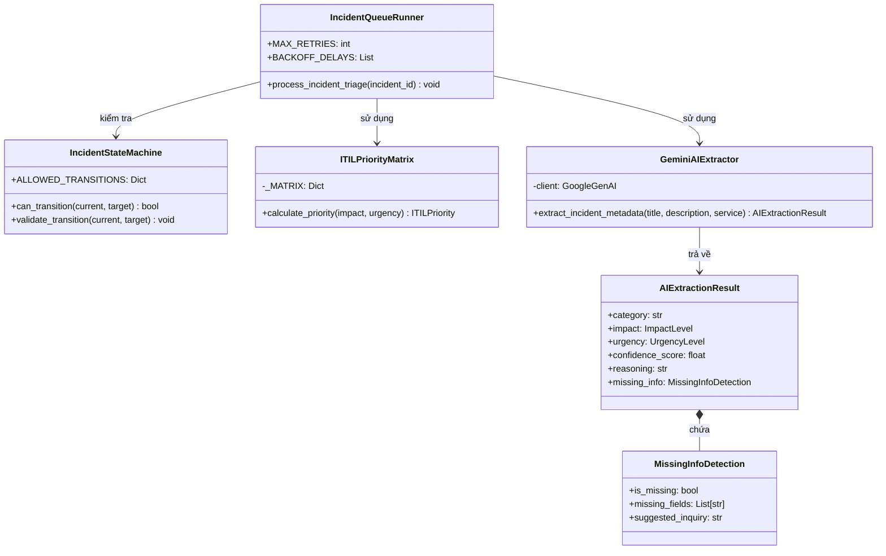

# 04-CODE — Code & Class Architecture (C4)
**Architecture Level:** C4 Level 4 (Code & Implementation Patterns)  
**Target Runtime:** Python 3.12 · FastAPI 0.111+ · Pydantic v2 · SQLAlchemy 2.0 Async  
**Status:** IN PROGRESS (Đang triển khai)

> [!NOTE]
> **Trạng thái tài liệu:** 🟡 **Đang triển khai (In Progress)**  
> Phần thiết kế chi tiết cấu trúc mã nguồn, các lớp nghiệp vụ (Class Design) và các hàm xử lý đang trong quá trình hoàn thiện và cập nhật liên tục song song với tiến độ lập trình Backend.

Tài liệu đặc tả cấu trúc mã nguồn, thiết kế các lớp (Class Design), các mẫu thiết kế (Design Patterns) và các hàm xử lý cốt lõi của hệ thống **IT Incident Triage System**.

---

## I. CẤU TRÚC THƯ MỤC DỰ ÁN BACKEND (CODEBASE STRUCTURE)

Hệ thống backend được tổ chức theo kiến trúc phân tầng rõ ràng (**Layered Architecture**), phân định giữa tầng API, tầng Domain Nghiệp vụ, tầng Service điều phối và tầng Persistence dữ liệu:

```
backend/
├── app/
│   ├── api/                    # Tầng Giao tiếp HTTP (Routers & Endpoints)
│   │   ├── v1/
│   │   │   ├── auth.py         # /auth (Login, Logout, Me)
│   │   │   ├── deflection.py   # /deflection (Suggest, Feedback)
│   │   │   ├── incidents.py    # /incidents (CRUD, Status Transition)
│   │   │   ├── reviews.py      # /incidents/{id}/review (HITL Approve/Override)
│   │   │   ├── knowledge.py    # /knowledge (RAG Similar, Runbooks)
│   │   │   ├── analytics.py    # /analytics/dashboard
│   │   │   └── health.py       # /health
│   │   └── dependencies.py     # FastAPI Depends: get_db, get_current_user, require_role
│   │
│   ├── core/                   # Cấu hình & Hạ tầng cốt lõi
│   │   ├── config.py           # Pydantic BaseSettings (ENV variables, DB URLs, API Keys)
│   │   ├── security.py         # JWT Token encode/decode, bcrypt hash/verify
│   │   └── database.py         # SQLAlchemy async engine, sessionmaker
│   │
│   ├── domain/                 # Thực thể nghiệp vụ & Quy tắc cốt lõi (Domain Core)
│   │   ├── state_machine.py    # Incident State Machine & Transition Rules
│   │   ├── itil_matrix.py      # ITIL 3x3 Deterministic Rule Engine
│   │   └── sla_calculator.py   # SLA response & resolution deadlines calculation
│   │
│   ├── schemas/                # Lược đồ Pydantic v2 (DTOs, Validation, LLM Schemas)
│   │   ├── incident.py         # Request/Response schemas cho Incidents
│   │   ├── ai_triage.py        # Pydantic Schema ép kiểu phản hồi Gemini AI
│   │   ├── review.py           # HITL Review & Override schemas
│   │   └── deflection.py       # Deflection suggestions & feedback schemas
│   │
│   ├── services/               # Điều phối nghiệp vụ (Application Services)
│   │   ├── ai_extractor.py     # Gemini LLM client service
│   │   ├── queue_runner.py     # Background task executor, Retry & DLQ handler
│   │   ├── rag_service.py      # Grounded RAG & Full-Text Search service
│   │   └── audit_service.py    # Audit logging service
│   │
│   ├── models/                 # SQLAlchemy 2.0 ORM Models
│   │   ├── user.py             # User model
│   │   ├── incident.py         # Incident model
│   │   ├── ai_triage.py        # AITriageResult model
│   │   ├── review.py           # IncidentReview model
│   │   ├── audit_log.py        # AuditLog model
│   │   └── task_queue.py       # TaskQueue model
│   │
│   └── repositories/           # Tầng truy xuất dữ liệu (Data Access Layer)
│       ├── incident_repo.py    # Incident CRUD & Filter queries
│       ├── task_queue_repo.py  # Queue status updates & DLQ marking
│       └── audit_repo.py       # Audit trail persistence
│
└── tests/                      # Bộ kiểm thử đơn vị & tích hợp
    ├── test_state_machine.py   # Test quy tắc chuyển trạng thái
    ├── test_itil_matrix.py     # Test ma trận ITIL 3x3
    └── test_ai_triage_flow.py  # Test luồng retry & DLQ
```

---

## II. THIẾT KẾ CÁC LỚP CỐT LÕI (CORE CLASSES & IMPLEMENTATION)

### 1. Incident State Machine (`app/domain/state_machine.py`)
Đảm bảo các trạng thái sự cố tuân theo biểu đồ chuyển tiếp hợp lệ, ngăn chặn việc cập nhật trạng thái nhảy cóc.

```python
from enum import Enum
from typing import Set, Dict

class IncidentStatus(str, Enum):
    PENDING_TRIAGE = "PENDING_TRIAGE"
    AI_SUGGESTED = "AI_SUGGESTED"
    MANUAL_TRIAGE_REQUIRED = "MANUAL_TRIAGE_REQUIRED"
    TRIAGED = "TRIAGED"
    IN_PROGRESS = "IN_PROGRESS"
    RESOLVED = "RESOLVED"
    CLOSED = "CLOSED"

class IncidentStateMachine:
    """Quản trị vòng đời sự cố và ràng buộc chuyển đổi trạng thái nghiêm ngặt."""

    # Bản đồ các bước chuyển đổi trạng thái hợp lệ
    ALLOWED_TRANSITIONS: Dict[IncidentStatus, Set[IncidentStatus]] = {
        IncidentStatus.PENDING_TRIAGE: {
            IncidentStatus.AI_SUGGESTED,
            IncidentStatus.MANUAL_TRIAGE_REQUIRED,
        },
        IncidentStatus.AI_SUGGESTED: {
            IncidentStatus.TRIAGED,
            IncidentStatus.MANUAL_TRIAGE_REQUIRED,
        },
        IncidentStatus.MANUAL_TRIAGE_REQUIRED: {
            IncidentStatus.TRIAGED,
        },
        IncidentStatus.TRIAGED: {
            IncidentStatus.IN_PROGRESS,
            IncidentStatus.RESOLVED,
        },
        IncidentStatus.IN_PROGRESS: {
            IncidentStatus.RESOLVED,
        },
        IncidentStatus.RESOLVED: {
            IncidentStatus.CLOSED,
            IncidentStatus.IN_PROGRESS,  # Mở lại sự cố nếu tái diễn
        },
        IncidentStatus.CLOSED: set(),     # Trạng thái kết thúc
    }

    @classmethod
    def can_transition(cls, current: IncidentStatus, target: IncidentStatus) -> bool:
        """Kiểm tra tính hợp lệ của việc chuyển từ trạng thái current sang target."""
        return target in cls.ALLOWED_TRANSITIONS.get(current, set())

    @classmethod
    def validate_transition(cls, current: IncidentStatus, target: IncidentStatus) -> None:
        """Kiểm tra và ném ngoại lệ nếu chuyển trạng thái trái phép."""
        if not cls.can_transition(current, target):
            raise ValueError(
                f"Chuyển đổi trạng thái không hợp lệ: không thể chuyển từ '{current.value}' sang '{target.value}'."
            )
```

---

### 2. ITIL 3×3 Priority Matrix Engine (`app/domain/itil_matrix.py`)
Mã nguồn thuần Python, xác định mức ưu tiên dựa trên bảng ma trận cứng $3 \times 3$, hoàn toàn không để AI quyết định tự do.

$$\text{Priority} = \text{Impact} \times \text{Urgency}$$

```python
from enum import Enum
from typing import Dict, Tuple

class ImpactLevel(str, Enum):
    HIGH = "HIGH"        # Toàn công ty / Hệ thống lõi
    MEDIUM = "MEDIUM"    # Một bộ phận / Chi nhánh
    LOW = "LOW"          # Một cá nhân

class UrgencyLevel(str, Enum):
    HIGH = "HIGH"        # Tê liệt hoàn toàn, không có cách thay thế
    MEDIUM = "MEDIUM"    # Ảnh hưởng nhưng có giải pháp tạm thời
    LOW = "LOW"          # Chưa ảnh hưởng ngay tới tiến độ

class ITILPriority(str, Enum):
    P1 = "P1"  # Nghiêm trọng (Critical)
    P2 = "P2"  # Cao (High)
    P3 = "P3"  # Trung bình (Medium)
    P4 = "P4"  # Thấp (Low)

class ITILPriorityMatrix:
    """Quy đổi tất định ma trận 3x3 Impact x Urgency ra độ ưu tiên ITIL P1-P4."""

    _MATRIX: Dict[Tuple[ImpactLevel, UrgencyLevel], ITILPriority] = {
        (ImpactLevel.HIGH, UrgencyLevel.HIGH): ITILPriority.P1,
        (ImpactLevel.HIGH, UrgencyLevel.MEDIUM): ITILPriority.P2,
        (ImpactLevel.HIGH, UrgencyLevel.LOW): ITILPriority.P3,

        (ImpactLevel.MEDIUM, UrgencyLevel.HIGH): ITILPriority.P2,
        (ImpactLevel.MEDIUM, UrgencyLevel.MEDIUM): ITILPriority.P3,
        (ImpactLevel.MEDIUM, UrgencyLevel.LOW): ITILPriority.P4,

        (ImpactLevel.LOW, UrgencyLevel.HIGH): ITILPriority.P3,
        (ImpactLevel.LOW, UrgencyLevel.MEDIUM): ITILPriority.P4,
        (ImpactLevel.LOW, UrgencyLevel.LOW): ITILPriority.P4,
    }

    @classmethod
    def calculate_priority(cls, impact: ImpactLevel, urgency: UrgencyLevel) -> ITILPriority:
        """Tính mức ưu tiên từ mức độ tác động và tính khẩn cấp."""
        priority = cls._MATRIX.get((impact, urgency))
        if not priority:
            raise ValueError(f"Không thể xác định mức ưu tiên cho Impact={impact}, Urgency={urgency}")
        return priority
```

---

### 3. Pydantic v2 Structured Output Schemas (`app/schemas/ai_triage.py`)
Đóng gói Prompt và ép kiểu phản hồi của Gemini LLM API vào cấu trúc JSON định sẵn thông qua Pydantic v2:

```python
from pydantic import BaseModel, Field
from typing import List, Optional
from app.domain.itil_matrix import ImpactLevel, UrgencyLevel

class MissingInfoDetection(BaseModel):
    """Thông tin kỹ thuật còn thiếu được phát hiện bởi AI."""
    is_missing: bool = Field(description="Có thiếu thông tin kỹ thuật cốt lõi hay không")
    missing_fields: List[str] = Field(
        default_factory=list,
        description="Danh sách các trường thông tin kỹ thuật còn thiếu (VD: Error code, screenshot, OS version)"
    )
    suggested_inquiry: Optional[str] = Field(
        default=None,
        description="Mẫu câu hỏi lịch sự gợi ý để IT Support gửi lại cho người dùng bổ sung"
    )

class AIExtractionResult(BaseModel):
    """Kết quả trích xuất ngữ nghĩa có cấu trúc từ Gemini LLM."""
    category: str = Field(
        description="Danh mục sự cố: Hardware, Software, Network, Security, hoặc Access"
    )
    impact: ImpactLevel = Field(
        description="Mức độ tác động: HIGH, MEDIUM, hoặc LOW"
    )
    urgency: UrgencyLevel = Field(
        description="Mức độ khẩn cấp: HIGH, MEDIUM, hoặc LOW"
    )
    confidence_score: float = Field(
        ge=0.0, le=1.0,
        description="Độ tin cậy của mô hình đối với kết quả phân tích (0.0 đến 1.0)"
    )
    reasoning: str = Field(
        description="Lập luận phân tích ngắn gọn làm cơ sở cho quyết định phân loại"
    )
    missing_info: MissingInfoDetection = Field(
        description="Kiểm tra độ đầy đủ thông tin kỹ thuật của sự cố"
    )
```

---

### 4. Queue Dispatcher, Retry & Dead-Letter Queue Runner (`app/services/queue_runner.py`)
Thực thi tác vụ gọi AI ngầm với chính sách thử lại tối đa 3 lần với Exponential Backoff (2s, 6s) và đưa vào Dead-Letter Queue nếu lỗi:

```python
import asyncio
import logging
from uuid import UUID
from app.domain.state_machine import IncidentStateMachine, IncidentStatus
from app.domain.itil_matrix import ITILPriorityMatrix
from app.services.ai_extractor import GeminiAIExtractor

logger = logging.getLogger(__name__)

class IncidentQueueRunner:
    """Xử lý tác vụ AI Triage ngầm với cơ chế thử lại và Dead-Letter Queue."""

    MAX_RETRIES = 3
    BACKOFF_DELAYS = [2, 6]  # Khoảng thời gian chờ giữa các lần thử lại (giây)

    def __init__(self, ai_service: GeminiAIExtractor, db_session_factory):
        self.ai_service = ai_service
        self.db_session_factory = db_session_factory

    async def process_incident_triage(self, incident_id: UUID) -> None:
        """Hàm thực thi chính chạy ngầm trong FastAPI BackgroundTasks."""
        attempt = 0
        last_error = None

        while attempt < self.MAX_RETRIES:
            attempt += 1
            try:
                logger.info(f"Bắt đầu AI Triage cho sự cố {incident_id} (lần thử: {attempt}/{self.MAX_RETRIES})")
                
                # 1. Lấy dữ liệu sự cố từ Database
                async with self.db_session_factory() as session:
                    incident = await session.get_incident_for_triage(incident_id)
                    if not incident:
                        logger.error(f"Không tìm thấy sự cố {incident_id} trong DB.")
                        return

                    # 2. Gọi Gemini AI trích xuất dữ kiện có cấu trúc
                    ai_result = await self.ai_service.extract_incident_metadata(
                        title=incident.title,
                        description=incident.description,
                        affected_service=incident.affected_service
                    )

                    # 3. Tính toán độ ưu tiên ITIL theo ma trận cứng 3x3
                    computed_priority = ITILPriorityMatrix.calculate_priority(
                        impact=ai_result.impact,
                        urgency=ai_result.urgency
                    )

                    # 4. Cập nhật trạng thái sự cố sang AI_SUGGESTED
                    IncidentStateMachine.validate_transition(
                        incident.status, IncidentStatus.AI_SUGGESTED
                    )
                    await session.save_ai_triage_success(
                        incident_id=incident_id,
                        ai_result=ai_result,
                        priority=computed_priority,
                        status=IncidentStatus.AI_SUGGESTED
                    )
                    logger.info(f"AI Triage thành công cho sự cố {incident_id}: Priority={computed_priority.value}")
                    return

            except Exception as exc:
                last_error = str(exc)
                logger.warning(f"Lỗi AI Triage sự cố {incident_id} (lần {attempt}): {last_error}")
                
                if attempt < self.MAX_RETRIES:
                    delay = self.BACKOFF_DELAYS[attempt - 1]
                    await asyncio.sleep(delay)

        # 5. Nếu vượt quá MAX_RETRIES, kích hoạt cơ chế Dead-Letter Queue (DLQ)
        logger.error(f"Quá 3 lần thử lại thất bại cho sự cố {incident_id}. Đẩy vào Dead-Letter Queue.")
        async with self.db_session_factory() as session:
            await session.mark_incident_as_dlq(
                incident_id=incident_id,
                status=IncidentStatus.MANUAL_TRIAGE_REQUIRED,
                error_message=f"DLQ: Gọi AI thất bại sau {self.MAX_RETRIES} lần thử lại. Chi tiết lỗi: {last_error}"
            )
```

---

## III. SƠ ĐỒ QUAN HỆ CÁC LỚP CHÍNH (CLASS RELATIONSHIP DIAGRAM)


